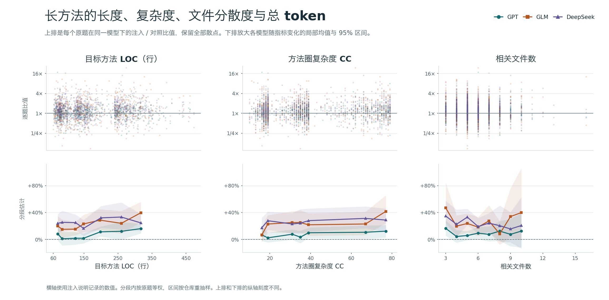
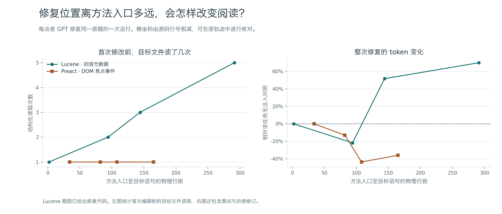

# 坏味的哪一部分会增加 AI 修复成本？

在 41 个仓库、297 道原题中，注入坏味后，三个模型整体都更费 token。换一个问题，问“同一道题的方法再长一倍、再多一个依赖类，会多用多少 token”，答案就不一样了。**只有 Long Method 的长度、圈复杂度和嵌套深度分别呈现弱正关联。它们一起变化，现有数据无法把其中任何一项确认为独立根因。** 轨迹记录了目标语句怎样移出首次阅读窗口、业务逻辑怎样移到另一个宿主，以及同一个读取请求为何会返回大得多的源码。

## 从实测横坐标读趋势

横轴取每个注入版本说明中记录的具体数值。方法 LOC 有 258 个不同取值（60–473），类 LOC 有 664 个（1,000–6,984）。外部属性数和嵌套层数天然是整数，散点放在实际整数位置。上排展示所有有效配对，下排按指标的局部取值汇总并放大纵轴。下排在 0% 以上说明这些任务平均比无注入时贵，曲线是否继续向上才回答“指标再增大是否还会更贵”。[三种坏味的 token 图](token-scatter.png) · [耗时图](time-scatter.png) · [成功率图](success-by-metric.png) · [全指标图册](output/pdf/metric-atlas.pdf)

为减少不同原题难度的干扰，以下估计只比较**同一道题的不同注入版本**。主分析保留三个模型遥测均完整的 2,380 个变体，对每一变体取三个模型的等权平均对数用量比，再以原题为固定效应。第一列每次只考察一个指标。第二列同时纳入该味型的三项主指标，以及相关文件数、模块数、平均结构距离。括号内是按仓库聚类的 95% 区间。

| 坏味及指标变化 | 单独考察时的总 token 变化 | 同时考虑六项指标后的变化 |
|---|---:|---:|
| Long Method，方法 LOC 翻倍 | **+5.2%（+1.2% ～ +9.3%）** | +5.8%（−9.2% ～ +23.3%） |
| Long Method，圈复杂度 CC 翻倍 | **+4.4%（+0.6% ～ +8.3%）** | −2.0%（−11.8% ～ +8.9%） |
| Long Method，最大嵌套加一层 | **+2.2%（+0.4% ～ +4.0%）** | +0.8%（−4.4% ～ +6.4%） |
| Long Method，相关文件多一个 | −1.1%（−5.0% ～ +3.0%） | −1.3%（−5.3% ～ +2.9%） |
| God Class，类 LOC 翻倍 | +0.7%（−2.2% ～ +3.6%） | +0.4%（−11.6% ～ +14.0%） |
| God Class，类方法复杂度之和 WMC 翻倍 | +1.1%（−2.9% ～ +5.2%） | +2.2%（−11.5% ～ +17.9%） |
| Feature Envy，访问的不同外部属性多一个 | +0.4%（−0.6% ～ +1.5%） | +2.1%（−1.0% ～ +5.3%） |
| Feature Envy，提供数据的外部类多一个 | +0.5%（−1.0% ～ +2.1%） | −1.1%（−6.1% ～ +4.2%） |

**无法拆分的原因可以在实验设计中直接计数。** 同题 Long Method 变体的 LOC 与 CC 相关系数为 0.941，CC 与嵌套深度为 0.942。逐对检查原题、目标文件、目标方法名都完全相同的 581 对 Long Method 变体，没有一对只改这三项中的一项。Feature Envy 有 194 对同目标变体，God Class 有 534 对，单独改变一项主指标的也是零。限定同一目标、或额外控制注入档位重新估算，仍无法分清谁是主因。用补丁独立计算目标文件的净增物理行数，一项指标单独估算时，Long Method 每净增 100 行对应 +4.9% token（+1.5% ～ +8.5%）。它同样随整套注入改变。

**耗时和成功率也没有可重复指认的单项因素。** 以方法 LOC 翻倍为例，单独估算耗时为 −1.2%（−6.1% ～ +4.0%），GPT 双边有判定的成功率差为 +1.0 个百分点（−3.2 ～ +5.3）。六指标模型里，每种结果各做 18 项比较。按 Holm 校正，token、耗时、成功率均无单项达到 0.05。这个结果限制的是对独立斜率的判断，整体成本差仍见于三个模型。[完整系数、样本数与区间](metric-effects.csv) · [整体与单模型结果](estimates.json)

## 一、状态和参数传递任务需要读到哪一行？

Lucene 收录了 9 道原题。其中 #12626 的题面直接给出 `Existing` 和 `Fix` 两个完整方法体，明示应当复制索引提交的 `userData`，还附有目标 PR 链接。#12196 丢的是短语查询的 `slop`。两道题最后都需要让某个值到达正确的位置，实际定位过程却有明显区别。[状态恢复原题](../../traj_results/opencode/gpt/None-LM/apache__lucene-12626/prompt.txt) · [查询参数原题](../../traj_results/opencode/gpt/None-LM/apache__lucene-12196/prompt.txt)

**#12626 要在替换索引分段列表时，同时恢复提交元数据。** 原版 `SegmentInfos.replace` 的方法体仅有两条直线语句。GPT 收到的题面已经把 `userData = other.userData;` 写在 `lastGeneration` 的下一行，对照运行按这段代码修改。注入版把分段文件名转换、段校验和其他状态更新展开到这个方法里，最后仍是同一个文件里的一行修复。下表的行距直接用轨迹所展示的源码行号相减。读取次数只数首次修改前对目标文件的结构化 `read`，并逐一核对了读取窗口。[原版实际读取](../../traj_results/opencode/gpt/None-LM/apache__lucene-12626/trajectory.jsonl#L6) · [注入版第一次读取](../../traj_results/opencode/gpt/LM-S2/apache__lucene-12626/trajectory.jsonl#L6) · [找到赋值的第五次读取](../../traj_results/opencode/gpt/LM-S2/apache__lucene-12626/trajectory.jsonl#L21)

| 注入记录的 LOC / CC / 嵌套 | 方法入口 → `lastGeneration` | 行距 | 首次修改前目标文件读取 | 截至首次修改轮的 token | 后续 token | 全程 token |
|---|---|---:|---:|---:|---:|---:|
| 原版，体内两条语句 | 1010 → 1012 | 2 | 1 | 27,621 | 79,916 | 107,537 |
| 89 / 15 / 4 | 1010 → 1104 | 94 | 2 | 38,623 | 45,567 | 84,190 |
| 137 / 38 / 6 | 1013 → 1157 | 144 | 3 | 72,948 | 89,991 | 162,939 |
| 279 / 64 / 8 | 1014 → 1305 | 291 | 5 | 105,543 | 76,926 | 182,469 |

可以用首次请求检验这个解释。原版从 975 行读 70 行，1012 行就在返回结果中。279 LOC 的版本从 980 行读 80 行，最多看到 1059 行，目标在 1305 行。GPT 随后分段读文件，并搜索 `lastGeneration`。与原版相比，截至首次修改多出 **77,922 token**，后续还少用 2,990。89 LOC 的版本也需要第二次读取，但它后续花得少，全程反而便宜。这个例子能把**定位阶段的代价**归到具体的窗口边界上，单看整个任务的 token 会错过这件事。

**#12196 要先设置短语匹配间距，再给查询包装权重。** 无注入时，GPT 把 `applySlop` 移到构建 `BoostQuery` 之前。注入版把 `applySlop` 膨胀到 296 LOC、CC 73、嵌套 8，然而故障发生在调用顺序。GPT 仍在调用方作相同的重排，两个版本首次修改前对目标文件都只用一次结构化读取，整次都是 12 轮。总 token 为 157,787 → 223,510。较大的输入仍有代价，轨迹没有出现 #12626 那种为了找到方法末尾而连续翻页的行为。[对照补丁](../../traj_results/opencode/gpt/None-LM/apache__lucene-12196/patch.diff) · [注入版补丁](../../traj_results/opencode/gpt/LM-S2/apache__lucene-12196/patch.diff)

#12626 最后的修复标签是原版未通过、279 LOC 版通过。两个 Agent 实际提交的都是补上同一句赋值，注入版在本地验证阶段还遇到 Gradle 下载超时。行距和日志定位了额外阅读，最终标签不足以说明更多阅读使修复更正确。[原版补丁](../../traj_results/opencode/gpt/None-LM/apache__lucene-12626/patch.diff) · [注入版补丁](../../traj_results/opencode/gpt/LM-S2/apache__lucene-12626/patch.diff) · [本地验证记录](../../traj_results/opencode/gpt/LM-S2/apache__lucene-12626/trajectory.jsonl#L37)

**Preact 提供了不同任务类型的反例。** 17 道 Preact 原题中，有两道明确要求修复 DOM 事件名或回调映射，分别是 `onInput/onChange` 和 `onFocusIn/onFocusOut`，只有后一道有 Long Method 配对。焦点事件修复要找到事件名转小写的分支。原版该分支在第 58 行，GPT 首次请求第 1 行起的 190 行。250 LOC、CC 50、嵌套 8 的注入版中，该分支在第 178 行，首次请求第 1 行起的 260 行，仍然可见。原版和三个注入版本都只读一次目标文件就开始改。注入版最终通过，token 从 197,059 降到 126,297。即使有 8 层嵌套，修复任务也可能根本无需逐层理解。[焦点事件原版读取](../../traj_results/opencode/gpt/None-LM/preactjs__preact-4316/trajectory.jsonl#L18) · [注入版读取](../../traj_results/opencode/gpt/LM-S2/preactjs__preact-4316/trajectory.jsonl#L6) · [同项目另一道事件题](../../traj_results/opencode/gpt/None-FE/preactjs__preact-3562/prompt.txt)

在更大样本中也检查了这个机制。GPT 有 784 对 Long Method 运行在首次修改前双边都用结构化工具读过目标文件，其中使用两个以上不同起始行的比例从 **32.0% 增至 51.5%**。进一步限定最终补丁为相同文件、同一个 hunk、完全相同的增删文本时，14 对从“首次窗口已包含修改位置”变为“不包含”，来自 11 道原题，按题等权 token 增加 32.7%。两边首次都命中的 74 对来自 39 道原题，增加 4.9%。这是按访问行为筛选的观察子集，前一组较小，适合检验上述过程是否也出现在其他轨迹。

## 二、校验消息任务要同时保住哪两种行为？

Laravel 的 13 道原题中，#51890 和 #52451 都要求修复校验失败后的消息生成。两题的 Feature Envy 版本都把关键方法从 `FormatsMessages` 搬到 `MessageBag`。这两道题都要先定位负责取文案的方法，改完之后还要确认其他类型的消息能正常生成。[阈值文案原题](../../traj_results/opencode/gpt/None-FE/laravel__framework-51890/prompt.txt) · [自定义规则原题](../../traj_results/opencode/gpt/None-FE/laravel__framework-52451/prompt.txt)

| 原题 | 无注入时 GPT 怎么修 | 有 Feature Envy 时 GPT 怎么修 | 截至首次修改轮的 token | 后续 token |
|---|---|---|---:|---:|
| #51890，`gt:0` 要显示数值 0 | 在比较规则的消息替换器中区分数值阈值与字段引用 | 沿消息查找追到新宿主 `MessageBag`，修缺失翻译的回退。中途因额外调用翻译器 `getLocale()` 打破严格 mock 的约定，需修订并重测 | 80,350 → 148,926 | 131,136 → 298,248 |
| #52451，自定义规则失败时仍需按属性生成消息 | 在 `FormatsMessages::getFromLocalArray` 内处理找不到规则键的属性消息数组 | 在 `MessageBag` 中修相同的选择逻辑。第一次把另一种合法数组也过滤掉，使 `size.string` 的定制文案失效。最终把限制收窄到自定义规则对象，普通大小规则继续原路径 | 189,298 → 203,178 | 121,379 → 348,909 |

两题双边最终都通过。#52451 的注入记录列出 13 个外部属性、6 个提供类，本类属性占比 0.071，相关文件 9 个。实际测试输出显示，第一次修改后，大小规则应返回用户自定义的文案，却返回了 `validation.size.string`。第二次仍失败，第三次修改后 676 个测试通过。两边的全程差为 241,410 token，其中 **227,530（94.3%）发生在首次修改轮之后**。对这个任务，最耗费的是分清在同一消息袋里流动的两种数组该如何处理。[注入说明](../../smell-patch-intro/S2/FeatureEnvy/laravel__framework-52451-FE.json) · [对照修改后的测试](../../traj_results/opencode/gpt/None-FE/laravel__framework-52451/trajectory.jsonl#L43) · [首次失败](../../traj_results/opencode/gpt/FE-S2/laravel__framework-52451/trajectory.jsonl#L47) · [再次失败](../../traj_results/opencode/gpt/FE-S2/laravel__framework-52451/trajectory.jsonl#L57) · [最终通过](../../traj_results/opencode/gpt/FE-S2/laravel__framework-52451/trajectory.jsonl#L70)

#51890 的提供类有 5 个，ATFD 为 12，跨模块数为 5。换成 DeepSeek，同一道题采用了另一种策略，直接把查找逻辑从消息袋迁回验证器使用的 `FormatsMessages`。这使原本的行为修复额外包含一次跨文件迁移，token 从 353,216 升到 590,281。[GPT 原版做法](../../traj_results/opencode/gpt/None-FE/laravel__framework-51890/trajectory.jsonl#L21) · [GPT 的 mock 错误](../../traj_results/opencode/gpt/FE-S2/laravel__framework-51890/trajectory.jsonl#L40) · [DeepSeek 实际改动](../../traj_results/opencode/deepseek/FE-S2/laravel__framework-51890/patch.diff)

对全部 629 个“新旧宿主是不同文件，并且都出现在注入补丁中”的变体，用同一对路径查询两边的工具日志。实际显式查过**两个宿主文件**的比例，GPT 从 20.3% 增至 43.4%（627 对），GLM 从 23.5% 增至 57.9%（625 对），DeepSeek 从 33.6% 增至 75.4%（625 对）。进一步只选同一道题既有“同文件迁移”版本、也有“跨文件迁移”版本的 62 题，三模型等权比较，后者的总 token 多 5.0%，区间为 −2.3% ～ +13.7%。跨文件查询这个行为很明确，把所有额外 token 都归到文件分散度上仍缺乏依据。

## 三、类的职责集中后，一次请求多读了什么？

Lombok 的 16 道原题中，#3326 处理 `@UtilityClass` 修改内部类后触发的 javac 泛型推断异常。修复需要在内部类改为静态后清掉仍记录外部实例参数的 `erasure_field` 缓存，并同步 javac 的符号桩声明。GLM 在对照与 God Class S2 都通过 Git 历史读到了目标 PR 的修复提交 `5f0582ba`。S2 的第 48 条记录实际返回 diff，第 51 条明确说将采用该修复，第 58、59 条分别把相应修改写入符号桩和处理器。因而这道题适合验证“读了多少代码”，不足以单独评估模型自行诊断错误的能力。[原题](../../traj_results/opencode/glm/None-GC/projectlombok__lombok-3326/prompt.txt) · [上游修复查询](../../traj_results/opencode/glm/GC-S2/projectlombok__lombok-3326/trajectory.jsonl#L51) · [提交给评测的改动](../../traj_results/opencode/glm/GC-S2/projectlombok__lombok-3326/patch.diff)

两侧首次读取都是 `read(HandleUtilityClass.java)`，均从开头读取，均未指定行数上限。原版文件在 159 行结束。注入把 getter、setter、构造器的校验与成员筛选等职责搬入同一类。类 LOC 记录为 5,347，WMC 为 1,087。这次实际只返回前 1,977 行，随即触及工具的 50 KB 输出上限。完整工具返回从 7,974 增至 62,222 个字符。三个注入版本的平均结构距离均为 2.0，整次任务 token 却随类 LOC 1,488、3,662、5,347 分别得到 686,202、1,291,919、776,009。这里可直接归因的是**源码集中改变了相同请求的输出量**。读取上限、是否继续翻页、查上游和跑构建的轮次，都会改变整次任务的结果。[原版读取](../../traj_results/opencode/glm/None-GC/projectlombok__lombok-3326/trajectory.jsonl#L16) · [注入版读取](../../traj_results/opencode/glm/GC-S2/projectlombok__lombok-3326/trajectory.jsonl#L9) · [类度量与迁入职责](../../smell-patch-intro/S2/GodClass/projectlombok__lombok-3326-GC.json)

对其他 God Class 轨迹做了相同请求复核。限制第一次修改前、同一个目标文件、两边首次读取均从第一行开始且均未指定上限，只计算工具实际返回的**源码字符**，去掉路径、行号和工具说明。

| 模型 | 相同默认请求，配对数 / 原题数 | 注入文件返回源码字符的中位倍数 | 还读过未修改文件的配对 | 在这个子集，注入文件 / 未修改文件各自的中位倍数 |
|---|---:|---:|---:|---:|
| GLM | 236 / 97 | 7.33× | 73 | 8.31× / 1.00× |
| DeepSeek | 108 / 50 | 6.70× | 36 | 9.93× / 1.00× |

在最后一列的 73 对和 36 对中，未修改文件的返回源码字符数逐对都相等。相同输入请求只有在改动过的目标上明显变重。这是本研究对“文件体积影响阅读”最直接的证据。这两个子集都选中了默认读取的运行，7.33×、6.70× 不能用来乘整次任务的 token 或估算所有模型。GPT 的访问方式不同，在 96 对同起点、同显式行数上限的请求中，目标文件返回字符数的中位倍数是 1.35×。

Gson 的 9 道题中，#2479 要给 `GsonBuilder` 的适配器注册增加一条拒绝规则。DeepSeek 两边都需要找到普通注册和层级注册两个入口、保留它们对于 `Object` 的不同约定、运行相应测试。注入后，一次 `JsonElement` 搜索额外匹配到迁入这同一个类的 JSON 树读写方法，结果延伸到 6,400 行以后。模型分段阅读、再查文档和用法，从 10 轮、139,996 token 增至 16 轮、288,529 token。三个注入版本的类 LOC 从 1,518 增到 3,076 再到 5,768，全程 token 却依次为 311,642、274,180、288,529。可观察到的负担是**同一个关键词命中更多与这次注册修复无关的职责**，仅用类 LOC 预测这三次运行的顺序会出错。[原版读取](../../traj_results/opencode/deepseek/None-GC/google__gson-2479/trajectory.jsonl#L10) · [注入后的实际搜索结果](../../traj_results/opencode/deepseek/GC-S2/google__gson-2479/trajectory.jsonl#L5)

## 四、一次未通过的修复把成本花在哪一步？

fmt 收录 11 道原题。#3158 要让 C++23 字符范围在字符串和范围 formatter 之间正确分派，同时保住嵌套范围、调试输出及转换产生的临时值。对照在 `core.h` 和 `ranges.h` 调整分类与嵌套调试格式，最终通过。注入把规格解析和类型校验内联进 `range_formatter::parse`，记录为 267 LOC、CC 79、嵌套 8、相关文件 3 个。GPT 截至首次修改反而少用 10,870 token（230,794 → 219,924）。之后它针对嵌套 formatter 尝试分派重载，修改转发签名，发现非 const 范围回归后撤回，再改成绑定映射后的元素。后段 token 从 681,248 增至 2,137,014。最后 Agent 报告仍有一个 `format_vector` 失败，评测将这次运行记为未通过。[原题](../../traj_results/opencode/gpt/None-LM/fmtlib__fmt-3158/prompt.txt) · [对照修订与测试](../../traj_results/opencode/gpt/None-LM/fmtlib__fmt-3158/trajectory.jsonl#L75) · [注入说明](../../smell-patch-intro/S2/LongMethod/fmtlib__fmt-3158-LM.json) · [转发签名回退](../../traj_results/opencode/gpt/LM-S2/fmtlib__fmt-3158/trajectory.jsonl#L191) · [末次验证说明](../../traj_results/opencode/gpt/LM-S2/fmtlib__fmt-3158/trajectory.jsonl#L210)

这和 Lucene 的 279 LOC 方法长度接近，耗费却落在不同阶段。Lucene 的额外工作发生在找到最后一条状态更新之前，fmt 的额外工作发生在首次修改后的兼容性返工。fmt 的另一注入版本（87 LOC、CC 17）也未通过。现有记录可以定位返工内容，不能据此认定“超过某个 CC 就会失败”，也无法还原最终判定失败的具体断言。

## 五、究竟是什么让 Agent 多定位、多读或返工？

对于同一道修复题，可以逐项核对 issue 点名的符号在哪里实现、定位词能区分哪些候选、判断分支离状态写回有多远，以及调用方如何使用返回值。下面固定原题，并尽可能固定工具输入，逐一查这些关系何时发生了改变。

**题面给出的修复代码在新实现中的位置发生变化。** Lucene #12626 的 issue 直接列出了 `SegmentInfos.replace` 修改前和修改后的完整代码。无注入时 GPT 将题面给出的改动用于原类，第一次编辑就成功。在 Feature Envy S0 中，移动的是周边逻辑，原来的一参数 `replace(SegmentInfos)` 仍在。S1、S2 则把这一参数方法本身移到了 `IndexWriter`。特别是 S2，GPT 给 `apply_patch` 的第一次输入与无注入时**逐字相同**，工具明确报错“找不到预期代码”。之后它追到 `IndexWriter.replace`，在那里把 `userData` 赋给实际被更新的对象。无注入、S0、S1、S2 四条轨迹首次成功修改前的源码 `read` 次数分别为 **1、1、5、5**。两次编辑的旧代码和新代码都与题面的两个代码块逐字一致。GPT 在这两次首次编辑前只做了本地搜索、读取或任务记录。S1 虽然同样发生迁移，GPT 第一次编辑就写到了正确的新文件。这个案例支持的解释是**把题面已给出的修法适配到变体有额外成本**，单靠它无法评估独立诊断能力。[题面给出的修复代码](../../traj_results/opencode/gpt/FE-S2/apache__lucene-12626/prompt.txt#L32) · [S1 首次编辑](../../traj_results/opencode/gpt/FE-S1/apache__lucene-12626/trajectory.jsonl#L34) · [同一补丁成功](../../traj_results/opencode/gpt/None-FE/apache__lucene-12626/trajectory.jsonl#L10) · [同一补丁失配](../../traj_results/opencode/gpt/FE-S2/apache__lucene-12626/trajectory.jsonl#L24) · [新位置修改成功](../../traj_results/opencode/gpt/FE-S2/apache__lucene-12626/trajectory.jsonl#L41)

**原定位词开始命中其他职责，真实入口甚至无须移动。** Gson #2479 要修改普通注册与层级注册两个方法，在这两个入口分别判断内置类型是否允许被覆盖。DeepSeek 的两条轨迹对同一份 `GsonBuilder.java` 执行了相同的 grep 表达式。无注入时返回 4 行。God Class S2 的两个注册入口仍在第 669、724 行，原 4 行全部保留，却多了 17 行，包括迁入的 JSON 树读写、类型描述等代码。相同搜索从 317 个输出字符变成 1,377 个字符。这直接增加一次工具调用带入上下文的文本，也使关键词对注册逻辑的辨别力下降。至于多出的 17 行中模型逐行考虑了多少，日志不能测量。[原版 4 个命中](../../traj_results/opencode/deepseek/None-GC/google__gson-2479/trajectory.jsonl#L6) · [注入版 21 个命中](../../traj_results/opencode/deepseek/GC-S2/google__gson-2479/trajectory.jsonl#L5)

**理解修复所必需的两处代码不再同时可见。** 在同一道已给出修复代码的 Lucene 题的 Long Method 变体中，方法仍在原类，改变的是从方法入口到最终写回状态的距离。原版同一次读取返回第 1010 行的方法头和第 1012 行的原赋值。S2 的首次读取返回 980～1059 行，实际赋值在 1305 行，必须取得后面的代码才能确认应在哪里加赋值。GPT 实际用了 5 次读取。前述 Preact 的 250 LOC 反例里，目标分支在第 178 行，第一次请求就覆盖 1～260 行，原版和该变体各只读一次。此处可预测额外读取的量，是当前问题需要的语句是否掉出了实际请求的窗口。[Lucene 首次窗口](../../traj_results/opencode/gpt/LM-S2/apache__lucene-12626/trajectory.jsonl#L6) · [定位到状态写回](../../traj_results/opencode/gpt/LM-S2/apache__lucene-12626/trajectory.jsonl#L21) · [Preact 首次窗口](../../traj_results/opencode/gpt/LM-S2/preactjs__preact-4316/trajectory.jsonl#L6)

**同一个返回值在两个调用场景有不同含义，第一次修改把条件放宽了。** Laravel #52451 中，当属性消息数组缺少自定义规则的键时，应让校验器使用该规则的回退文案。另一方面，内置大小规则要保留整份数组，随后按属性类型取出 `string` 等条目。无注入时 GPT 的同一次读取同时返回了 `FormatsMessages.php` 第 86～87 行的按类型取值和第 129 行的数组判断，第一次修改保留了“仅当键等于属性名”的限制。注入后，数组判断迁到 `MessageBag.php`，按类型取值仍在原文件。GPT 首次修改把“遇到数组但没找到规则键”普遍改成 `continue`，连合法的内置大小文案也跳过了。测试期望的是 `name should be of length 9`，实际得到 `validation.size.string`。两次测试失败后，轨迹第 63 条工具返回才首次出现按类型取值的那行代码，第 66 条编辑给 `continue` 加上自定义规则对象的条件，第 70 条运行 676 个测试通过。[原版同时看到两种行为](../../traj_results/opencode/gpt/None-FE/laravel__framework-52451/trajectory.jsonl#L33) · [注入版首次编辑](../../traj_results/opencode/gpt/FE-S2/laravel__framework-52451/trajectory.jsonl#L40) · [失败断言](../../traj_results/opencode/gpt/FE-S2/laravel__framework-52451/trajectory.jsonl#L47) · [补读调用方](../../traj_results/opencode/gpt/FE-S2/laravel__framework-52451/trajectory.jsonl#L63) · [收窄条件](../../traj_results/opencode/gpt/FE-S2/laravel__framework-52451/trajectory.jsonl#L66)

这项返工要分两层归因。代码注入把“是否返回数组”和“谁还需要这个数组”的证据分到了两个文件。直接引发测试失败的是 GPT 第一版补丁跳过了过多情形。仓中适配后的参考修复与无注入时 GPT 的补丁，删除的两行、增加的两行代码都逐字相同，修复位置换了。这说明原有业务约定一直存在，也存在一次改对的方案。实际多出的 241,410 token 中，227,530 发生在首次修改轮之后。[无注入时的改动](../../traj_results/opencode/gpt/None-FE/laravel__framework-52451/patch.diff) · [注入后仍然足够的参考修复](../../smell-patch/S2/FeatureEnvy/laravel__framework-52451-FE-gold.patch)

另做了同一工具输入的配对核查。在 7,151 个遥测完整、提示词相同、没有测试适配补丁的配对里，542 对能在首次可识别改写前找到双方都执行过且能取得完整命中数的同参数结构化 grep。每对取对照顺序下首个重合查询，命中数在 70 对里增加、453 对里相同、19 对里减少。在首次结构化编辑输入可匹配的 641 对中，635 对两边都成功。这些数字只描述选择了相同操作的运行。上述案例说明怎样从代码变化追到下一次工具动作，不能据此给所有带相同坏味标签的任务分配相同成本。运行 `python3 analysis/smell_impact/action_inputs.py` 可复核。[同输入核查脚本](action_inputs.py)

## 证据的适用范围

- **指标来源。** 2,424 份注入说明都能关联到补丁和原题。三项主指标均有数值。RAD 的文件数、模块数、平均结构距离衡量说明中认定与坏味相关的工件。共有 7 个 RAD 字段缺值，按分析所需字段逐项排除。LOC、CC、WMC 等来自注入说明的记录，仓库未提供全量基线源码和统一静态分析器的复测输出。基线没有这些字段的位置不会补零。
- **独立核对。** 另外从目标文件补丁计算净增物理行数。对 748 个有目标文件总行数日志的 God Class 变体，14 个的类 LOC 超过各次可读日志中的最大目标文件行数。跨文件类型或统计口径差异都值得考虑。排除这 14 个变体，类 LOC 翻倍的六指标估计是 −0.4%（−12.4% ～ +13.3%），解释不变。全文区分了类或方法的有效 LOC、文件物理行数、工具实际返回的字符和 API 记录的 token。
- **统计口径。** 主模型用同题固定效应和仓库聚类 CR1 标准误，区间采用仓库数减一的 t 分布。完整六指标模型分别用了 FE 782、GC 776、LM 813 个变体。三模型只在都有有效遥测时进入主分析，每个变体不重复计三次。成功率只用 GPT 双边都有判定的配对。图的分段不拆开相同 x 值，至少含 15 道不同原题和 5 个仓库才展示局部估计，原始散点全部保留。图册前四页对应 token，中间四页对应耗时，最后四页对应成功率。
- **轨迹口径。** 读取窗口以结构化 `read` 实际返回的源码行号为准。匹配同一请求时要求路径、起始行和上限相同，且发生在首个可识别的改写动作以前。未改文件对照排除了所有注入改动路径和带测试适配补丁的配对。分阶段 token 以第一次成功的结构化编辑所处模型轮次为界，包含该轮的用量计入前段。先出现可能改写文件的 shell 命令时不拆分。工具查询还可能走 shell 或间接脚本，未观察到显式请求只表示该方法未捕获。
- **推广边界。** 项目内的任务数从归档原题去重得到。文中列出的功能子类按 issue 描述界定，是用于检验机制的具体子类。运行没有随机交错安排，GPT、GLM 的注入组全部早于对应对照。固定原题、核对同一请求、检查反例可以减少部分解释空间，仍不能把全程耗时或成功率的全部差异归给单一结构属性。此分析只覆盖已归档的三类 Code Smell。

逐点数据提供每项实际指标、配对用量、首次编辑用量、读取窗口及对应轨迹行号。运行入口仍为 `uv run --python 3.12 analysis/smell_impact/study.py`。[逐点数据](paired_tasks.csv.gz) · [回归表](metric-effects.csv) · [区间、样本与源码行号](estimates.json) · [分析入口](study.py)

## 题面给出的解法与 Agent 主动查询的上游修复

| 任务与会话 | 解法如何进入上下文 | 能从轨迹核实什么 |
|---|---|---|
| Lucene #12626，GPT 对照与 Feature Envy S2 | 题面直接给出了 `Existing`、`Fix` 两个完整代码块和目标 PR 链接 | 两侧首次 `apply_patch` 的输入逐字相同。将该编辑还原为修改前、修改后两段源码，分别与题面的两段代码完全相同。此前的可见操作是本地检索、读取或任务记录，两条 GPT 轨迹均未记录查询历史提交或打开目标 PR。对照首次编辑成功，S2 首次编辑因上下文失配而未写入，随后在 `IndexWriter` 完成修改。[题面](../../traj_results/opencode/gpt/FE-S2/apache__lucene-12626/prompt.txt#L24) · [失配](../../traj_results/opencode/gpt/FE-S2/apache__lucene-12626/trajectory.jsonl#L24) · [适配到新位置](../../traj_results/opencode/gpt/FE-S2/apache__lucene-12626/trajectory.jsonl#L41) |
| Lucene #12626，GLM、Feature Envy S2 | 除题面已经给出的解法，还主动请求了同题上游 PR 的 diff | 第 36 条说明要核对上游修复，第 37 条 `webfetch` 的输出返回真实 diff，里面有新增的 `userData = other.userData;`，第 41 条确认看到了该修复。同一道题的不同模型有不同取证结果。[意图与访问](../../traj_results/opencode/glm/FE-S2/apache__lucene-12626/trajectory.jsonl#L36) · [返回的目标 PR diff](../../traj_results/opencode/glm/FE-S2/apache__lucene-12626/trajectory.jsonl#L37) |
| Lombok #3326，GLM、God Class S2 | 从上游 Git 仓库的历史定位目标 PR，读取实际修复提交 `5f0582ba` | Git 工具输出给出清除 `innerClassSymbol.erasure_field` 和补充符号桩字段的改动。GLM 自述要应用同一修复，随后两处代码被写入并出现在最终补丁中。无注入对照也能从其本地 Git refs 中读取同一提交。这是有直接证据的参考答案使用。[对照的 Git 输出](../../traj_results/opencode/glm/None-GC/projectlombok__lombok-3326/trajectory.jsonl#L34) · [S2 的 Git 输出](../../traj_results/opencode/glm/GC-S2/projectlombok__lombok-3326/trajectory.jsonl#L48) · [采纳说明](../../traj_results/opencode/glm/GC-S2/projectlombok__lombok-3326/trajectory.jsonl#L51) · [最终补丁](../../traj_results/opencode/glm/GC-S2/projectlombok__lombok-3326/patch.diff#L15) |

Lucene 的 GPT 例子中，“旧补丁”这个简称容易误导。更准确的说法是“按题面原方法生成的编辑”。这两次编辑是事后配对比较，日志没有显示 GPT 调取另一组运行的补丁。相同的修复提示在原版仍然精确，在迁移后的版本中却指向旧位置。因此额外读取包含适配过时题面线索的成本。Lombok 中则可以观察到主动取得、随后使用上游修复内容的完整过程。求解提示词明确要求避免查看或索要基准的 gold patch。[任务约束](../../traj_results/opencode/glm/GC-S2/projectlombok__lombok-3326/prompt.txt#L12)

**以 297 道不同原题为分母，至少 65 道（21.89%）有轨迹实际取得本题上游修复。** 同一道题跨模型、坏味和注入档位只计一次。64 道（21.55%）有原生 `webfetch` 返回同仓库、同编号目标 PR 的 diff 正文。GLM 涉及 61 题、DeepSeek 4 题，二者重合的是 Jekyll #9141。另有 1 道 Lombok #3326 从 Git 提交历史取得并采用了修复，未与这 64 题重合。Lucene #12626 已计在 64 题内，其题面给解不重复加题。其余 232 道（78.11%）在当前核查口径下未检出。读到 diff 与依据该 diff 作答是两个证据强度，全库的实际采纳比例尚未逐题核定。[297 道题逐题清单](answer_access_by_task.csv) · [目标 PR 原始证据](target_pr_access.csv) · [复算脚本](answer_sources.py)

把这 64 道题以及另行核实本地或上游历史取解的 Lombok #3326 一并从所有模型排除，共排除 65 道原题。剩余配对按题等权，GPT 的 token 增幅为 +8.8%（1,869 对），GLM 为 +32.1%（1,868 对），DeepSeek 为 +29.8%（1,862 对）。总体成本方向在这次剔除后仍然存在。其余题目还可能有本次筛选未覆盖的答案来源。
