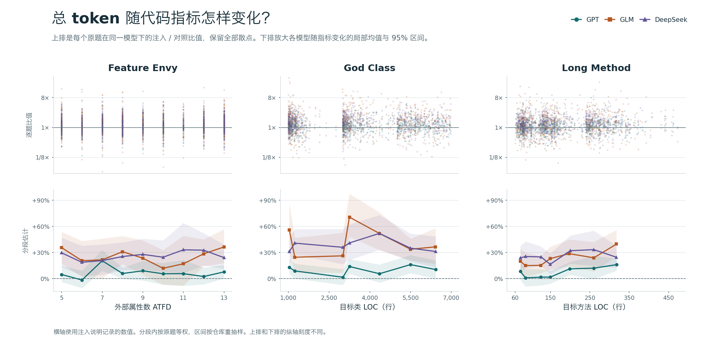
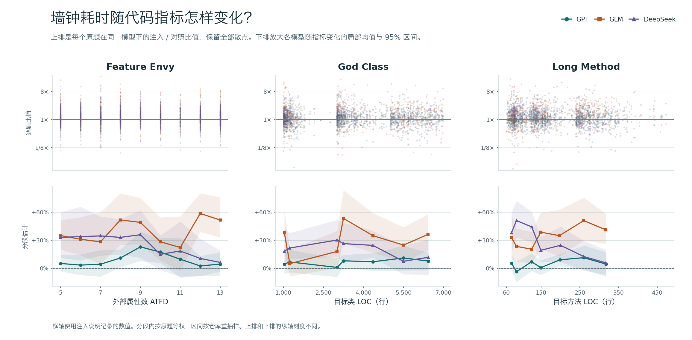
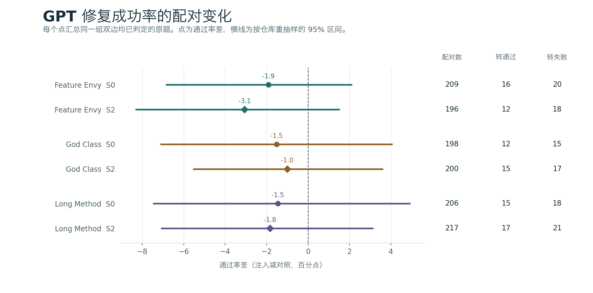
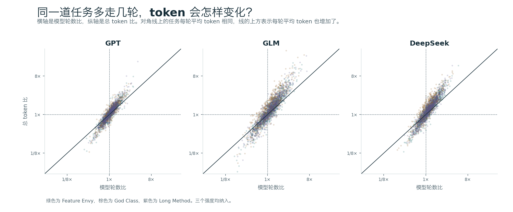

# 代码坏味如何改变 AI 修复任务的过程

基于 `Smell_Data` 的 `a5c37038` 数据快照。研究对象是 OpenCode 在 SWE-bench Multilingual 上修复原始 issue 的行为。本文覆盖 Feature Envy、God Class 和 Long Method。仓库目前只对这三类 Code Smell 设置了实验组。

**最清楚的差异出现在修复成本。** 同一道题注入坏味后，GPT、GLM、DeepSeek 的总 token 分别增加 7.8%、30.9%、29.5%。三个模型都更频繁地回到已看过的相关文件。GPT 有 895 对运行在注入前后都通过了评测，在这一子集中，注入组仍多用 11.9% 的 token。**成功率的证据更弱。** GPT 的六组通过率差都偏负，按原题汇总后为 −1.2 个百分点，95% 区间从 −4.9 到 +2.3 个百分点。GLM 和 DeepSeek 的轨迹支持分析成本，仓库尚缺这两个模型的最终测试判定。

**哪些属性造成了开销？** 按实际数值重算后，Long Method 的 LOC、圈复杂度、嵌套深度分别与总 token 有弱正关联，但三者随注入一起变化，现有设计识别不了唯一因素。证据更直接的是具体开发步骤。Lucene 一项状态恢复修复中，方法入口到状态赋值从 2 行拉长到 291 行，GPT 首次改代码前从一次读取增至五次。Laravel 的消息处理任务则主要把额外 token 花在首次修改后的兼容性返工上。详细分析逐题列出了原始需求、代码位置、相同读取请求的输出、分阶段 token 和反例。[连续指标与修复过程](METRIC_FINDINGS.md) · [完整指标图册](output/pdf/metric-atlas.pdf)

## 1. Token 与耗时

每个配对都固定原题、模型和该坏味对应的无注入对照。下表先在每道题内平均各注入条件的对数比值，再给每道原题相同权重，最后换算成百分数。括号内是按原始仓库聚类、重抽样 5,000 次得到的 95% 区间。耗时是 Agent 的墙钟时间，包含工具执行和等待。

| 模型 | 可用配对 / 不同原题 | 总 token 变化 | 耗时变化 | 用更多 token 的配对 | 用时更长的配对 |
|---|---:|---:|---:|---:|---:|
| GPT-5.6-Terra | 2,415 / 297 | +7.8%（+3.3% ～ +12.0%） | +6.2%（+0.7% ～ +10.7%） | 58.5% | 55.8% |
| GLM-5.3-Flash | 2,409 / 297 | +30.9%（+24.5% ～ +37.9%） | +34.8%（+25.1% ～ +45.0%） | 64.0% | 67.0% |
| DeepSeek-V4.1-Flash | 2,399 / 296 | +29.5%（+20.4% ～ +38.3%） | +24.4%（+14.0% ～ +35.8%） | 67.5% | 64.6% |

散点图保留了全部 7,223 个有效配对，横坐标使用每个注入版本记录的外部属性数、目标类 LOC 或目标方法 LOC。上排每一点是一道题的一对运行，1× 表示用量或耗时相同。下排按各段实测值分别计算原题等权的几何平均变化，放大显示局部均值及仓库聚类区间。折线用于比较相邻观测段，机制归因另做同题回归和轨迹核对。

**哪一种坏味代价更高？** 合并三个强度后，God Class 的 token 增幅在三个模型中都是最大值。各味型能注入的原题集合略有不同，因此也做了第二项比较。只取同一模型、原题和强度，且三种注入都在一小时内启动的运行，直接比较三种注入。God Class 相对 Feature Envy 的 token 差为 GPT +4.2%（+0.1% ～ +8.3%）、GLM +10.8%（−3.6% ～ +26.7%）、DeepSeek +9.4%（+2.4% ～ +16.4%）。这组比较减弱了运行日期和选题差异，但仍包含注入规模的差别。

| 模型 | Feature Envy 相对无注入 | God Class 相对无注入 | Long Method 相对无注入 | 同时段三种注入都可比的题目 × 强度数 |
|---|---:|---:|---:|---:|
| GPT | +6.7% | +10.0% | +7.5% | 630 |
| GLM | +26.6% | +40.4% | +22.4% | 197 |
| DeepSeek | +25.8% | +36.8% | +25.7% | 567 |

**强度的趋势以 Long Method 最清楚。** 它的任务级 token 中位增幅在三个模型里均按 S0、S1、S2 递增。如果进一步要求 S0、S2 是同一道题，直接比较 S2 与 S0，GPT 多用 7.9%（+3.0% ～ +13.0%），GLM 多用 13.1%（+3.0% ～ +23.6%），DeepSeek 多用 5.1%（−4.8% ～ +15.7%）。Feature Envy 和 God Class 的峰值随模型而变。例如 DeepSeek 的 God Class 中位增幅依次是 31%、51%、40%。这些按类型和强度拆开的区间是单项区间，适合读趋势。

## 2. 成功率为何没有同样清楚的下降

通过是评测报告将原题列入 `resolved_ids`。以下六组都只使用双方获得通过或未通过判定的同一批原题。“转通过”统计对照失败而注入通过的原题，“转失败”是相反方向。

| 条件 | 原题数 | 对照通过 → 注入通过 | 转通过 / 转失败 | 通过率差，百分点（95% 区间） |
|---|---:|---:|---:|---:|
| Feature Envy S0 | 209 | 171 → 167 | 16 / 20 | −1.9（−6.9 ～ +2.1） |
| Feature Envy S2 | 196 | 162 → 156 | 12 / 18 | −3.1（−8.3 ～ +1.5） |
| God Class S0 | 198 | 165 → 162 | 12 / 15 | −1.5（−7.1 ～ +4.1） |
| God Class S2 | 200 | 164 → 162 | 15 / 17 | −1.0（−5.6 ～ +3.6） |
| Long Method S0 | 206 | 163 → 160 | 15 / 18 | −1.5（−7.5 ～ +4.9） |
| Long Method S2 | 217 | 179 → 175 | 17 / 21 | −1.8（−7.1 ～ +3.2） |

六组一共 1,226 对，来自 250 道原题。895 对均通过，135 对均失败，87 对转通过，109 对转失败。按题等权的 −1.2 个百分点容许小幅负效应和小幅正效应。六次双侧精确 McNemar 检验的原始 p 值为 0.36 ～ 0.86，Holm 校正后均为 1.00。每组真正用来判断方向的信息只有 27 ～ 38 个翻转，且六组共享部分原题和对照。

两种观察有助于解释这个结果。

- **Agent 能多花工作量，保住部分修复。** 在两边都通过的 895 对中，涉及 202 道原题，注入组 token 多 11.9%（+7.4% ～ +16.2%），耗时多 10.1%（+4.8% ～ +14.8%）。修复者能看到工作区的回归测试，轨迹中能观察到改错后重试并重新通过的过程。这支持“部分任务用更多工作换回相同结果”的解释。按最终结果分组选出了特定类型的任务，不能据此估算额外每一轮救回了多少题。
- **判定缺失和运行波动都足以改变表面方向。** Long Method S2 的原始通过数从 186 增到 205，双方都得出判定的任务中却是 179 降到 175。若将该组所有缺少二元判定的任务都视为未知，按最有利与最不利分配，全组风险差范围是 −10.1 到 +14.4 个百分点。另一方面，在两次不同会话、都无额外注入且均有判定的 52 道 GPT 原题中，有 5 道自身就翻转了。[对照报告](../../bench_result/opencode__ikuncode__gpt-5.6-terra.opencode-gpt-none-lm.json) · [S2 报告](../../bench_result/opencode__ikuncode__gpt-5.6-terra.opencode-gpt-lm-s2.json)

## 3. 多出来的 token 花在哪里

每条有效轨迹都满足“总 token ＝ 模型轮数 × 每轮平均 token”。模型轮数按 OpenCode 的 `step_finish` 计，包含工具调用后的后续模型轮次。用同一批配对及相同的原题权重，这两个因子的倍数相乘恰好还原总 token 倍数。额外读取行为用另一套证据衡量，即工具实际查询的路径和回传文本。

| 模型 | 模型轮数变化 | 每轮平均 token 变化 | 至少两次查看同一注入相关文件的配对占比，对照 → 注入¹ | 涉及这些文件的读取/检索回传字符增量² |
|---|---:|---:|---:|---:|
| GPT | +3.6% | +4.1% | 39.3% → 54.4% | +4,686 |
| GLM | +12.7% | +16.2% | 61.8% → 75.8% | +10,111 |
| DeepSeek | +12.8% | +14.8% | 80.0% → 91.5% | +14,825 |

¹ 对每个注入版本，从其补丁列出实际改动的文件，在处理组和对照组使用完全相同的路径集合。统计跨不同工具调用再次显式查询同一路径。² 计入命中路径的阅读、检索调用实际返回的全部字符，多文件命令可能同时返回其他内容。这里的字符数是工具输出量，与模型的 tokenizer 计数分别计算。

这也解释了**为什么只看生成的答案或最后一份补丁会低估开销**。一次多读的文件会留在后续请求的上下文中。三种模型的注入组，缓存读取占各运行总 token 的中位数约为 88%、93%、92%。扣除缓存读取后，GPT、GLM、DeepSeek 的剩余 token 仍分别增加 7.6%、19.1%、13.6%。总 token 能衡量模型处理的工作量，要折算费用还需要供应商的计费口径。

三种模型中，轮数变化与总 token 变化的 Spearman 相关均约为 0.91。这两个量存在算术依赖，因此还检查了**轮数完全相同**的配对。GPT 的 218 对、GLM 的 80 对、DeepSeek 的 136 对中，token 中位数仍分别增加 1.9%、7.2%、8.7%。按题等权，每题中可识别的阅读/检索调用分别多 0.68、2.97、3.12 次，可识别的测试命令则分别变化 −0.19、+0.30、+0.26 次。三个模型一致增加的行为集中在阅读和定位。

### 三类结构如何改变修复行为

**Feature Envy 增加跨文件追踪。** 修复入口仍可由 issue 找到，实际持有逻辑的类却换了位置。三个模型每题显式查看的注入相关文件种数分别多 0.26、0.40、0.64 个。Laravel 的 `gt:0` 验证消息任务中，注入把翻译查找从 `FormatsMessages` 移到了 `MessageBag`。GPT 先沿原比较规则查找，再读新旧位置，修改后又遇到翻译器 mock 对 `getLocale()` 的限制。轨迹记录了两次全文件测试返回同一个错误，最后的评测通过。对照只用 15 轮、211,486 token，注入用 24 轮、447,174 token。DeepSeek 在同题上采取另一种做法，直接把查找逻辑迁回 `FormatsMessages`，轮数 17 → 23，token 353,216 → 590,281。两条轨迹都出现了由方法迁移引出的额外工作。[注入说明](../../smell-patch-intro/S2/FeatureEnvy/laravel__framework-51890-FE.json) · [GPT 对照](../../traj_results/opencode/gpt/None-FE/laravel__framework-51890/trajectory.jsonl#L21) · [GPT 测试错误](../../traj_results/opencode/gpt/FE-S2/laravel__framework-51890/trajectory.jsonl#L40) · [DeepSeek 的实际补丁](../../traj_results/opencode/deepseek/FE-S2/laravel__framework-51890/patch.diff)

**God Class 让同一文件承载更多无关候选代码。** 三个模型每题对已看过的注入相关文件分别多回访 0.81、1.89、3.14 次。Gson 的适配器注册任务中，DeepSeek 对注入后的 `GsonBuilder` 搜索 `JsonElement`，还命中了新增的树读写方法，结果延伸到 6,400 行以后。它随后分段读类、查调用和文档。无注入是 10 轮、139,996 token，注入是 16 轮、288,529 token。两条轨迹都运行了定向和模块 Maven 测试，仓内只提供它们的运行轨迹。[注入说明](../../smell-patch-intro/S2/GodClass/google__gson-2479-GC.json) · [对照读取](../../traj_results/opencode/deepseek/None-GC/google__gson-2479/trajectory.jsonl#L10) · [注入后的搜索与分段读取](../../traj_results/opencode/deepseek/GC-S2/google__gson-2479/trajectory.jsonl#L5)

**Long Method 的代价取决于修复点能否直接定位。** Lucene 的 `SegmentInfos.replace` 修复只需复制 `userData`。无注入的 GPT 读一次方法附近的代码就定位了赋值点。注入把原方法展开为含校验和多步状态更新的长流程，GPT 按多个行区间阅读同一文件，再搜索 `lastGeneration`，最终仍只加了一行。用量从 107,537 升到 182,469 token。Preact 的 `onFocusIn`/`onFocusOut` 有可精确搜索的名字，GPT 一次就读到了膨胀后的 `setProperty` 中的目标分支。两边都通过，注入反而从 16 轮减至 10 轮，token 从 197,059 降至 126,297。长方法增加了可能要检查的代码，局部线索的明确程度影响一次具体修复会用到多少。[Lucene 对照](../../traj_results/opencode/gpt/None-LM/apache__lucene-12626/trajectory.jsonl#L6) · [Lucene 分段读取](../../traj_results/opencode/gpt/LM-S2/apache__lucene-12626/trajectory.jsonl#L6) · [Preact 对照](../../traj_results/opencode/gpt/None-LM/preactjs__preact-4316/trajectory.jsonl#L18) · [Preact 注入后直接定位](../../traj_results/opencode/gpt/LM-S2/preactjs__preact-4316/trajectory.jsonl#L13)

### 用失败和反向轨迹检验解释

- **多读有时仍然失败。** 在 fmt 的 C++ 范围格式化任务里，GPT 的 Long Method S2 轨迹反复调整嵌套 formatter 的分派与引用类别，发现新的回归后撤回改动。它最终报告仍有一项本地失败，并将其归于已有基线。对照获评通过，注入获评未通过，轮数 36 → 65，token 912,042 → 2,356,938。轨迹直接证明了返工；最终评测具体是哪一条断言失败，仓内没有逐项日志。[对照轨迹](../../traj_results/opencode/gpt/None-LM/fmtlib__fmt-3158/trajectory.jsonl#L85) · [注入后的回退](../../traj_results/opencode/gpt/LM-S2/fmtlib__fmt-3158/trajectory.jsonl#L191) · [最终验证说明](../../traj_results/opencode/gpt/LM-S2/fmtlib__fmt-3158/trajectory.jsonl#L210)
- **判定翻转也可能出现在相同修复上。** 在同一道 Lucene 题中，GPT 对照和 God Class S2 都在同一文件、同一方法、同一条赋值之后增加 `userData = other.userData;`，最终却是对照未通过、注入通过。对照在 Agent 侧跑过定向测试，注入侧下载 Gradle wrapper 失败。六组中的 196 个翻转有 5 个连改动路径和增删行文本都相同，底层代码和测试环境仍可能有别。凭通过标签无法把这些例子归为 Agent 的代码理解变好或变差。[对照补丁](../../traj_results/opencode/gpt/None-GC/apache__lucene-12626/patch.diff) · [注入补丁](../../traj_results/opencode/gpt/GC-S2/apache__lucene-12626/patch.diff) · [工具实际返回的网络错误](../../traj_results/opencode/gpt/GC-S2/apache__lucene-12626/trajectory.jsonl#L20)
- **额外轮数解释不了所有 token，外部参考也能改变解题路径。** GLM 在 Lombok 两个版本都读取了已有修复提交。在 God Class S2 中，它明确提到应用该上游修复。两侧读的是同一个 `HandleUtilityClass.java`，一次读取的返回量分别为 7,974 和 62,222 个字符。注入侧轮数反而从 26 降到 24，总 token 却从 481,404 升到 776,009。这同时展示了每次读取的体积效应和现成补丁对能力判断的干扰。[对照读取](../../traj_results/opencode/glm/None-GC/projectlombok__lombok-3326/trajectory.jsonl#L16) · [注入后读取](../../traj_results/opencode/glm/GC-S2/projectlombok__lombok-3326/trajectory.jsonl#L9) · [上游修复记录](../../traj_results/opencode/glm/GC-S2/projectlombok__lombok-3326/trajectory.jsonl#L51)

## 4. 这些结论能推广多远

| 复核方法 | GPT 的 token 变化 | GLM 的 token 变化 | DeepSeek 的 token 变化 |
|---|---:|---:|---:|
| 仅三类坏味都覆盖的 228 道原题 | +8.3% | +28.3% | +29.3% |
| 按仓库固定拆分，27 个仓库 | +8.4% | +30.8% | +28.0% |
| 其余 14 个仓库独立汇总 | +6.7%（−1.0% ～ +14.3%） | +31.1%（+21.6% ～ +43.5%） | +32.2%（+18.8% ～ +44.6%） |
| 剔除任一侧带网页获取、克隆、指定提交查询等标记的配对 | +8.1%（2,286 对） | +29.4%（1,023 对） | +26.4%（1,216 对） |

14 个仓库中，每道任务显式读取或检索注入相关文件的次数仍分别多 0.53、1.24、2.10 次，三者的 95% 区间都在零以上。这个按仓库的拆分验证了机制在不同代码库中的表现。GPT 的总量效应较小，单看这 14 个仓库，token 区间包含零。网页和历史查询过滤会同时排除正常参考，并不能识别全部上游补丁访问。

有三项限制直接影响归因。

1. **运行批次与处理条件高度重合。** 以轨迹首事件时间计，GPT、GLM 的有效配对全部是先跑注入、后跑对照，DeepSeek 为 97.0%。相隔时间中位数分别为 2.23、3.63、1.06 天。模型服务、依赖下载、构建缓存、机器负载都可能影响墙钟时间。源文件读取行为有路径证据，耗时百分比只能解释为本次运行的观测差异。
2. **同一题的单次运行本身就有波动。** 每个模型有 55 道原题在两个无注入目录中留下不同会话。用较大 token 数除以较小值，在有完整遥测的 GPT 55 对、GLM 55 对、DeepSeek 51 对中，中位数分别为 1.30、1.50、1.32。研究能识别跨题趋势，对单题成本的预测要保留这一级别的不确定性。
3. **坏味的组织方式与补丁规模共同变化。** 仅 S2 注入补丁，Feature Envy、God Class、Long Method 的新增行数中位数分别为 84、6,028、274，包含搬移和展开的代码。God Class 的读入压力有直接证据，但当前设计没有等规模、保持正常组织方式的重构对照，难以把全部差值单独归给“职责集中”。数据也尚不足以推断真实团队开发、人类用时或独立架构坏味的效应。

在这些任务里，**Agent 为查清逻辑现在放在哪里、同一段控制流如何结束、别的职责是否也受影响，付出了额外的阅读和核对工作。不同模型增加的轮数和每轮处理的 token 量也不同。** 在目前可复核的修复判定中，这份额外工作常常伴随相同的最终结果，也有成功和失败互换的情形。要把成本增幅解释为纯粹的坏味因果效应，仍需要同批随机交错运行、相同资源预算、重复采样和等规模重构对照。

## 数据口径与复算

- 41 个原始仓库、297 道不同原题。三类的可注入题数分别为 267、264、277，各有 S0、S1、S2 三档，S0 已注入。每模型的三个对照目录共享 228 道原题的同一会话。模型汇总先按原题等权，再按仓库重抽样，保留同一题各条件间的依赖。
- 7,272 个预期资源配对中，7,260 对两侧均有求解提示词；替换唯一容器名后文本全部相同。7,223 对两侧都正常结束（运行状态 `COMPLETED`、末轮 `stop`、正耗时、已结束轮次的 token 报数齐全），可计算资源变化。该分析覆盖完成运行的成本。通过率另用评测报告，不以 Agent 状态代替。
- Token 累加每个会话内去重后的 `step_finish.part.tokens.total`，核对输入、输出、推理和缓存读写之和。口径为父轨迹可见用量。排除出现委派工具的配对、或要求每次 `step_start` 都有对应的总数量 `step_finish` 时，三个模型的总 token 方向一致。工具文本按日志中实际返回的输出或错误计一次，排除元数据中的重复预览。显式路径和测试命令规则会漏掉间接脚本、变量路径及部分构建工具，行为计数属于可复核的近似量。
- 27/14 个仓库按仓库名的固定哈希拆分，按整个仓库分组。区间使用百分位聚类 bootstrap，种子为 20261118。该拆分是同一归档内的稳健性检查。本文没有重新运行模型或基准测试。
- 在仓库根目录运行 `uv run --python 3.12 analysis/smell_impact/study.py` 可重算指标、图像和完整图册。绘图需要可用的中文系统字体。[统计入口](study.py) · [轨迹抽取](measure.py) · [逐题配对数据](paired_tasks.csv.gz) · [分组估计与区间](estimates.json) · [连续指标回归表](metric-effects.csv)
