# 代码坏味如何影响 AI 辅助开发？
## 基于 41 个开源仓库、7,223 组对比实验的底层根因拆解、治理阈值与基准重设计

> 数据快照：`Smell_Data@a5c37038`（41 个仓库 · 7 种语言 · 297 道真实缺陷 · 2,424 份注入补丁 · 9,696 条完整轨迹）
> 研究对象：OpenCode 智能体分别搭载 **GPT-5.6-Terra**、**GLM-5.3-Flash**、**DeepSeek-V4.1-Flash**，在干净代码与坏味代码上修复同一缺陷。

<div class="tldr-box">
  <div class="tldr-title">先看结论：全篇最关键的三个发现</div>
  <div class="tldr-item">
    <div class="tldr-q">问题 1：坏味到底影响什么？ → 主要推高开发成本（+8% 至 +31%），强模型稳住通过率，轻量模型易“算力翻倍”</div>
    <div class="tldr-a">旗舰模型 GPT 靠多花 <b>7.8%</b> Token（每题中位 +2.5 万）保住了修复通过率（仅波动 −1.2 个百分点）；两款轻量模型平均多花约 <b>30%</b> Token、多走 <b>13%</b> 步数，且约 <b>1/4</b> 的任务出现单题成本翻倍。</div>
  </div>
  <div class="tldr-item">
    <div class="tldr-q">问题 2：为什么按 S0→S2 看“有坏味就涨价，加重却不涨”？ → 表面分档锁死了关键变量；改按“改动文件数”和“函数内分支数”画图，开销单调上升</div>
    <div class="tldr-a">原实验在轻度档（S0）就已打破跨文件边界（透支 68%～88% 涨幅），后续往大类末尾塞数千行无关并列方法会被 AI 的局部读取窗口自动跳过。一旦改按<b>实际改动的生产文件数</b>或<b>新增控制流分支数</b>重画曲线，三模型开销全线单调递增；同题回归中，表面 S0–S2 档位净效应归零（p &gt; 0.38）。</div>
  </div>
  <div class="tldr-item">
    <div class="tldr-q">问题 3：什么时候该介入治理？ → 别等文件上千行才按体积切分，聚焦高频修改模块守住三条逻辑红线</div>
    <div class="tldr-a">一旦打破职责边界就已付出八成代价，事后把 6,000 行大类切半几乎不省钱。最高效的干预是在热点模块<b>阻止异质职责混入</b>、<b>让核心逻辑留在数据持有类内</b>，并将单个函数控制在 <b>160 行 / 4 层嵌套以内</b>（保留具名小函数路标，防 AI 漏修深层缺陷提前交卷）。</div>
  </div>
</div>

---

## 1 核心框架与实验设计：透过坏味表象看三大底层逻辑成因

讨论代码坏味时，如果只停留在“上帝类、长方法、依恋情结”这些表面名称，很难看清 AI 究竟受阻在哪里。事实上，AI 编程智能体遵循**“① 入口检索 → ② 局部逻辑剥离 → ③ 落笔修改锚定 → ④ 契约验证与返工”**的四步闭环推进工作；三类经典坏味的本质，是分别退化了代码的三个底层结构属性，进而卡住了闭环中的不同环节（表 1）。

**表 1　从表面坏味到底层逻辑维度：AI 辅助开发受阻机理总览**

| 底层逻辑维度 | 结构退化本质（静态指标） | 典型表象 | 击穿的 AI 工作环节 | 真实影响曲线形态 | 核心治理原则 |
|---|---|---|---|---|---|
| **职责分离度**<br>（内聚与信噪比） | 多个无关业务职责混居同一命名空间，类内聚度（TCC）坍塌，同域词汇碰撞 | 上帝类 | **② 逻辑剥离 + ④ 多轮重算**：检索命中膨胀，单次读取涌入大量干扰代码并反复计费 | **破界即阶跃，纯堆并列方法迅速饱和** | 拦截异质职责混入；重构必须恢复职责边界，仅按行数拆分无效 |
| **数据–行为局部性**<br>（耦合与契约归属） | 核心方法脱离状态持有类（LAA 骤降），形成跨文件委托壳（文件跨度扩张） | 依恋情结、跨模块反向委托 | **② 双端核对 + ④ 契约误伤**：被迫跨双文件比对状态，改共享宿主易误伤其他调用方 | **在“1→2 个文件”且触及故障逻辑时跃迁** | 保持核心逻辑与所操纵的数据同处一类，消除无谓转发壳 |
| **控制流复杂度**<br>（分支与可切片性） | 具名子函数被内联压平为深层嵌套（5～8 层）与密集分支（CC 20～80） | 长方法、巨型内联流程 | **② 跨屏翻页 + ③ 编辑失配 + 漏修根因**：超出单屏窗口、缩进失配报错、修表面漏深层 | **随必经分支数持续单调爬升（~160 行拐点）** | 硬限函数 ≤160 行、嵌套 ≤4 层，保留具名小函数作语义路标 |

**基准与度量方法。** 实验基于多语言缺陷基准 SWE-bench Multilingual（Java、JS/TS、Go、Rust、PHP、Ruby、C/C++ 七种语言、297 道历史缺陷），在保持外部功能完全等价并经容器测试校验的前提下，向修复热点区（98% 为核心修改路径 E4）分别注入依恋情结（267 题）、上帝类（264 题）与长方法（277 题）的轻（S0）、中（S1）、重（S2）三档变体，共形成 **7,223 组有效同题配对运行**（272,200 次工具调用）。为穿透表面档位，我们从 2,424 份补丁与轨迹中直接提取**补丁实际改动生产文件数**、**新增控制流分支关键字数（$\Delta\text{Branches}$）**、**核心故障点纠缠标记**（原标准修复补丁是否因结构变动被迫重写，即是否存在 `-gold.patch`）以及四阶段工具轨迹。全部统计采用按原题等权的几何平均变化与按仓库聚类的 4,000 次 Bootstrap 95% 置信区间。

---

## 2 影响表现与曲线真相：为什么表面走平，换对横轴却单调上升？

### 2.1 全局账单：理解成本普涨，强模型通过率稳健

图 1 与表 2 展示了三款模型在四个评测维度上的整体表现及 S0/S1/S2 分档对比。

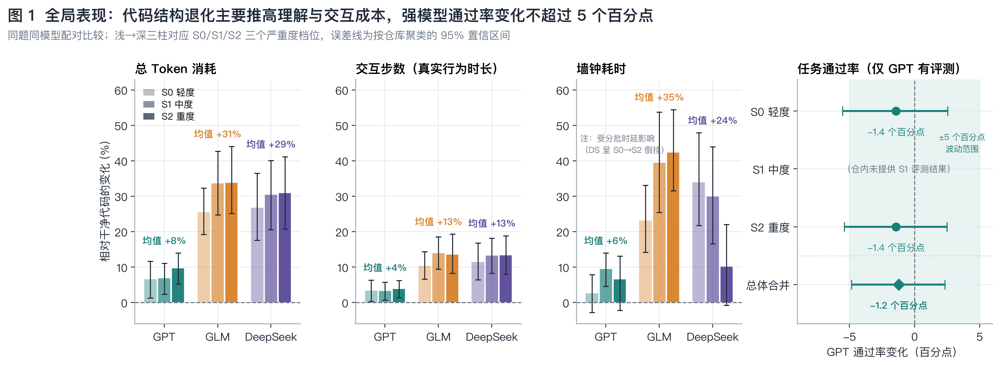

**表 2　注入坏味后的全局变化（按原题等权的几何平均变化及 95% 置信区间）**

| 模型 | 有效配对 / 原题数 | 总 Token 变化 | 交互步数变化（真实行为时长） | 单步上下文均值变化 | 墙钟耗时变化* | 每题中位额外开销 |
|---|---|---|---|---|---|---|
| GPT-5.6-Terra | 2,415 / 297 | **+7.8%**（+3.3, +11.9） | +3.6%（+1.1, +5.9） | +4.1% | +6.2%（+0.7, +10.7） | +2.5 万（基线 29.9 万） |
| GLM-5.3-Flash | 2,409 / 297 | **+30.9%**（+24.5, +37.9） | +12.7%（+9.0, +16.2） | +16.2% | +34.8%（+25.0, +45.0） | +9.0 万（基线 46.7 万） |
| DeepSeek-V4.1-Flash | 2,399 / 296 | **+29.5%**（+20.3, +38.2） | +12.8%（+8.0, +17.4） | +14.8% | +24.4%（+13.9, +35.7） | +13.1 万（基线 53.4 万） |

\* 注：墙钟耗时受分批运行的服务端响应速度漂移干扰（GLM 接触坏味前单步已慢 +14%，DeepSeek 呈 S0→S2 倒挂），评估智能体真实时间投入应以**交互步数**为准。

全局来看，坏味使智能体步数更多、每步背负的历史上下文更重，令轻量模型总开销上涨约三成，强模型上涨约 8%。在交付质量上（仓库仅归档了 GPT 在干净代码、S0 与 S2 下的 1,226 组测试判定），GPT 在 S0 与 S2 下的通过率变化均为 −1.4 个百分点（合并 **−1.2 个百分点**，95% CI −4.9 ～ +2.3，McNemar $p \ge 0.36$），与干净代码自身重跑的自然翻转率（9.6%）无异——强模型能够靠多读几轮消化结构坏味。

### 2.2 解开曲线之谜：跳出 S0–S2 标签，按“生产文件跨度”重画呈清晰单调递增

按现行 S0→S1→S2 分档观察（图 2、表 3），会出现一个反直觉现象：**轻度阶段（S0）已占去重度阶段总涨幅的 68%（GPT）、78%（GLM）与 88%（DeepSeek）**；继续加重到 S2，依恋情结几乎走平，上帝类在 S2 甚至回落，唯独长方法持续爬升。

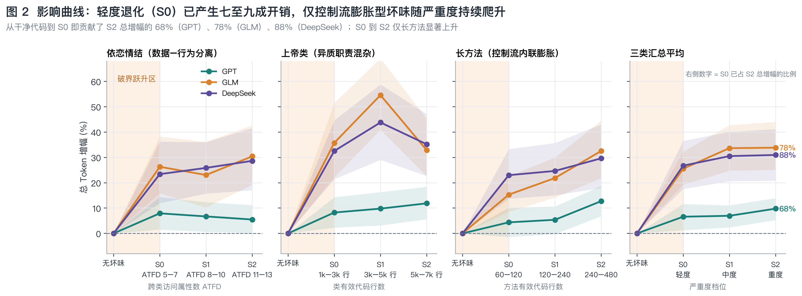

**表 3　现行 S0 → S1 → S2 分档下的总 Token 增幅（%）及底层结构中位数**

| 坏味类型 | 结构指标中位数（S0 → S1 → S2） | GPT（S0 / S1 / S2） | GLM（S0 / S1 / S2） | DeepSeek（S0 / S1 / S2） |
|---|---|---|---|---|
| **依恋情结** | 外部属性 6→9→12；改动文件 **2→2→2**；波及文件 5→5→6 | +7.9 / +6.7 / +5.5 | +26.3 / +23.1 / +30.4 | +23.4 / +25.9 / +28.7 |
| **上帝类** | 新增行数 1.2k→3.5k→6.0k；改动文件 **6→6→6**；波及文件 7→7→7 | +8.3 / +9.8 / +11.9 | +35.8 / +54.6 / +32.9 | +32.5 / +43.8 / +35.2 |
| **长方法** | 方法行数 81→149→274；圈复杂度 18→35→70；改动文件 **1→1→1** | +4.4 / +5.4 / **+12.7** | +15.3 / +21.9 / **+32.6** | +23.0 / +24.7 / **+29.6** |
| **三类汇总** | 新增行数 94→151→279；波及文件 **6→6→6**；跨模块 **3→3→3** | **+6.6 / +7.0 / +9.8** | **+25.6 / +33.7 / +33.9** | **+26.8 / +30.5 / +31.0** |

如果剥离人为设定的 S0–S2 标签，直接以**补丁实际改动的生产文件数**为横轴重画全量曲线，并在同一原题内部做控制变量回归比拼，真相便一目了然（图 3）：

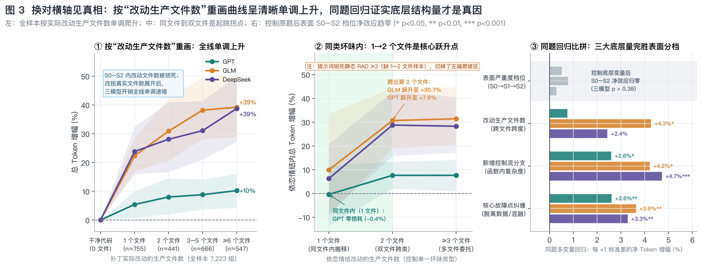

1. **按“改动生产文件数”展开后，全样本三模型曲线全线单调递增（图 3 ①）。** 现行 S0、S1、S2 内部的改动生产文件数中位数完全锁死（表 3）；一旦按真实改动文件数（`0 → 1 → 2 → 3–5 → ≥6 个文件`）重排全部 7,223 组配对，三模型开销同步单调爬升：**GLM 从 +22.3% 升至 +30.9% → +38.2% → +39.2%，DeepSeek 从 +23.8% 升至 +28.1% → +31.1% → +38.8%，GPT 从 +5.4% 升至 +8.0% → +8.8% → +10.2%**。
2. **同类坏味内，“1 个文件 → 2 个文件”正是起跳拐点，而静态 `RAD ≥ 3` 硬约束切掉了左端爬坡区（图 3 ②）。** 在依恋情结内部，当方法仅在**同一个生产文件内**搬移（1 文件，`n=96`）时，GPT 额外开销为 **−0.4%（零损耗）**，GLM 与 DeepSeek 也仅 +9.9% 与 +6.2%；一旦**跨出第 2 个生产文件**（`n=369`），三模型立刻跃升至 **+7.6%、+30.7% 与 +28.8%（翻了 3～5 倍）**。反观注入提示词中的静态波及文件数 `RAD`，因协议硬性锁死 `RAD ≥ 3`（全数据集 1～2 文件样本数为 0），人为抹平了早期的敏感爬坡段。
3. **同题多变量“赛马回归”证实：控制底层结构量后，表面 S0–S2 档位净效应归零（图 3 ③）。** 在同一道原题的 9 个变体内消除题目难度差异后，将表面档位（`S0→S2`）与三项底层结构量放入同一回归：表面档位净效应在三模型上均趋近于 0 且不显著（+0.3% ～ +0.8%, $p > 0.38$），而**改动生产文件数、新增控制流分支数、核心故障逻辑纠缠**显著主导了成本增长（每 +1 标准差带来 +2.6% ～ +4.7% 净增幅）。

### 2.3 视野过滤机制：横向并列堆砌被局部窗口屏蔽，纵向塞分支必读

图 4 与表 4 进一步从智能体的实际读取视野，解释了为什么“往大类里塞五千行代码不涨价，往长函数里加两百行却猛涨”。

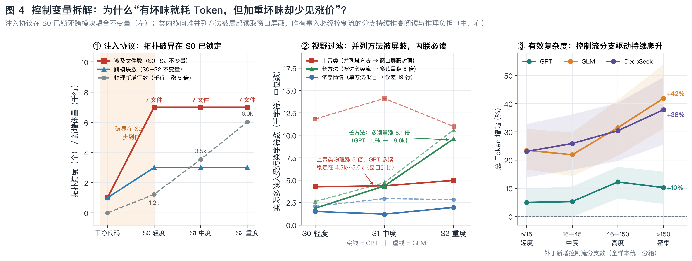

**表 4　S0 → S2 控制变量对照：物理代码增长方向与智能体实际读入字符中位数**

| 坏味类型 | S0–S2 锁定的拓扑不变量 | S0 → S2 放开的变化量（中位数） | 智能体实际读入受污染文件字符数（S0 → S1 → S2） | 视野过滤解释 |
|---|---|---|---|---|
| **依恋情结** | 只搬 1 个方法留转发壳；改动恒为 2 文件 | 外部属性 6→12，但**新增代码仅 65→78→84 行** | GPT 增量：`+1.5k → +1.2k → +2.0k`<br>GLM 增量：`+2.1k → +2.9k → +2.8k` | 跨文件破界在 S0 已完成，物理体量仅差 19 行 |
| **上帝类** | 波及恒为 7 文件、改动恒为 6 文件 | 在类末尾**横向追加孤立并列方法**（1.2k→6.0k 行） | GPT 总读：**`18.4k → 18.8k → 18.3k`**<br>GLM 总读：`31.0k → 34.2k → 27.2k` | `grep` 定位加限长读取屏蔽了无关方法；>5k 行放弃翻页致 S2 反降 |
| **长方法** | 改动恒为 1 文件、跨 3 模块 | 在待修函数体内**纵向塞入控制流分支**（78→274 行） | GPT 增量：**`+1.9k → +4.4k → +9.6k`**（涨 5.1 倍）<br>GLM 增量：**`+2.6k → +4.7k → +10.6k`**（涨 4.1 倍） | 膨胀逻辑卡在函数入口与修改点之间，无法跳过，驱动成本单调爬升 |

简言之，现代智能体通过关键词检索定位目标方法后按窗口分段读取（GPT 100% 限长读取，工具另有 50KB 截断上限）：**类末尾横向堆砌的几千行并列兄弟方法根本不会进入上下文**；甚至当文件超过 5,000 行（上帝类 S2）时，智能体看到总行数提示后直接放弃连续翻页（GLM 读取起点数从 S1 的 2.38 个回落至 1.84 个），反而造成 S2 比 S1 更省。相反，**函数内部纵向塞入的控制流分支**挡在理解逻辑的必经路径上，迫使多读字符翻了 4～5 倍，使全样本开销随分支增量单调攀升（图 4 ③）。

---

## 3 执行轨迹根因拆解：AI 进文件后究竟卡在哪一步？

### 3.1 四阶段轨迹与上下文复利重算：找门不慢，贵在进门后剥离、改错与轮轮计费

将全部轨迹拆解为四个阶段后（图 5），首先排除了一种常见误解：**坏味并没有让 AI 找不到目标文件**——首次定位并打开目标文件前的检索步数差接近 0（−0.03 ～ +0.10 步）。真正的阻力全部发生在进门之后：

- **阶段 ② 局部逻辑剥离变慢**：读完文件到首次下刀修改之间，GLM 与 DeepSeek 平均多花 **+2.13 步与 +1.65 步**反复检索和阅读，GPT 在上帝类上也多花 **+1.27 步**（+20%）。
- **阶段 ③ 结构化编辑报错翻倍**：深层缩进与内联产生的相似重复块，使编辑工具频繁报出上下文匹配失败——GLM 报错率从 **4.4% 升至 10.8%（×2.5 倍）**，DeepSeek 从 **1.5% 升至 3.1%（×2.1 倍）**。
- **阶段 ④ 多轮复利重算放大代价**：由于大模型每走一步都要重读完整历史上下文（缓存读取占总 Token 的 88%～93%），前期多吞入的混杂代码会在后续十几轮里被反复计费。逐轮增量核算（图 6）证实，净增 Token 中有 **47%～77%** 直接来自受污染文件内容的重复重算（上帝类达 71%～105%），而测试命令本身输出不足 1%。

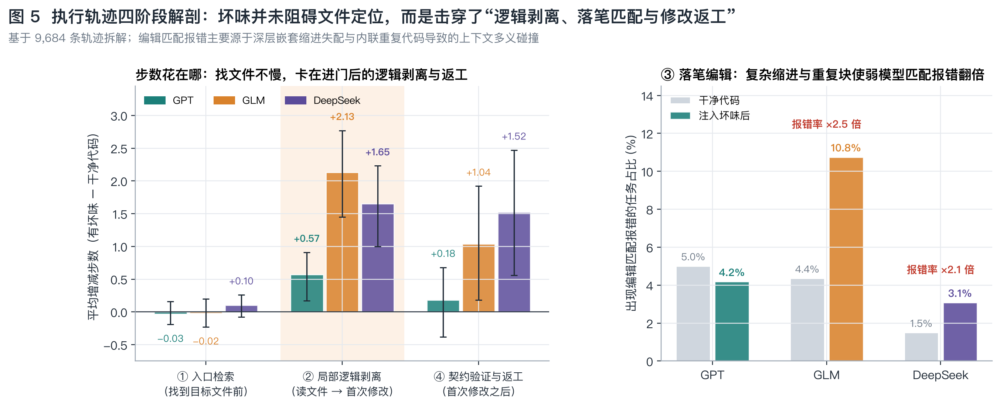

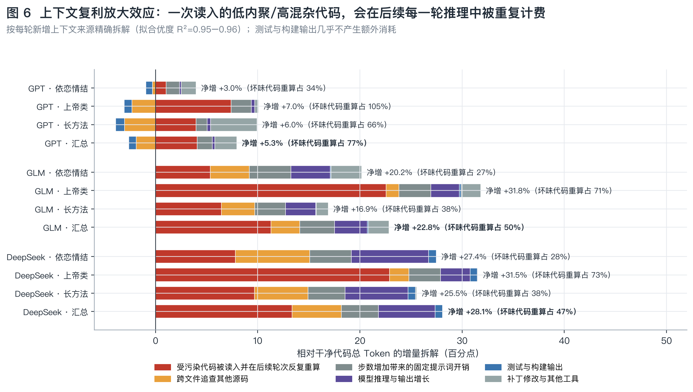

### 3.2 三大底层退化的代码级机理与真实案例

结合具体补丁与轨迹行为指标（图 7～图 9），三类底层逻辑问题分别通过以下机制制造损耗或缺陷：

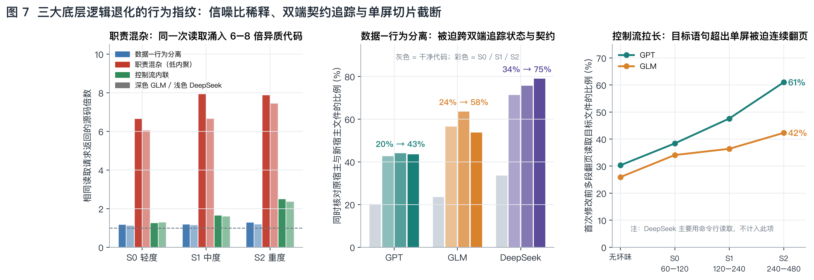

1. **职责混杂稀释搜索信噪比（图 7 左）**。当一个类吸收多个同域外部类后（TCC 跌至 0.004），共享的领域词汇使 `grep` 命中条数膨胀 **20%～35%**，相同默认读取请求返回 **6.1～8.0 倍**异质源码。例如在 `apache__druid-14092` 中，`DruidLeaderClient` 混入了上层协调器的状态码判断逻辑后，GPT 无法一次看清重试契约边界，被迫连发 5 次复杂正则搜索并追查 3 个外部管理类，工具调用从 19 次增至 29 次。
2. **核心逻辑脱离数据宿主引发双端核对与共享契约误伤（图 7 中、图 8）**。跨文件搬移使新旧双宿主同查率翻倍（20%～34% 升至 43%～75%）。更重要的是（图 8 左）：若仅迁走周边辅助方法，GPT 几乎零损耗（**+0.4%**）；一旦**待修复的核心方法自身脱离数据宿主**，同题内 GPT 开销立即增加 **+8.7%**，GLM 从 +12.3% 飙升至 **+30.8%**。如 `laravel__framework-52451` 中，校验消息查找逻辑被迁入通用容器 `MessageBag` 后，GPT 首次修改误伤了同容器的内置 `size.string` 规则，多花的 24.1 万 Token 中有 **94.3% 耗在兼容性返工上**。
3. **控制流突破 ~160 行窗口触发翻页拐点，抹除具名子函数诱发“漏修提前收工”（图 7 右、图 9）**。GPT 默认每次读取约 180 行：方法在 **160 行以内**仅增 +2.5%，跨过 **160 行**（嵌套 5～8 层）后多段翻页率从 30% 升至 61%，额外开销跳升 5 倍至 **+13.1%**（同批次内对比为 +1.2% 对 +15.4%）。更隐蔽的是，原本充当“语义路标”的具名小函数被压平进巨型分支后，AI 极易修完表面异常就草率交卷——如 `phpoffice__phpspreadsheet-3659` 中，GPT 在 275 行、8 层嵌套的 `parse()` 里修完表层字符串转换报错便提前结束，漏掉了深埋其中的跨表解析缺陷。在 GPT 全部 79 道成败分化原题中，**未通过变体比同题通过变体反而少花 14.2% Token、少走 9.8% 步数、少跑 0.79 次测试**（$p < 0.002$）。

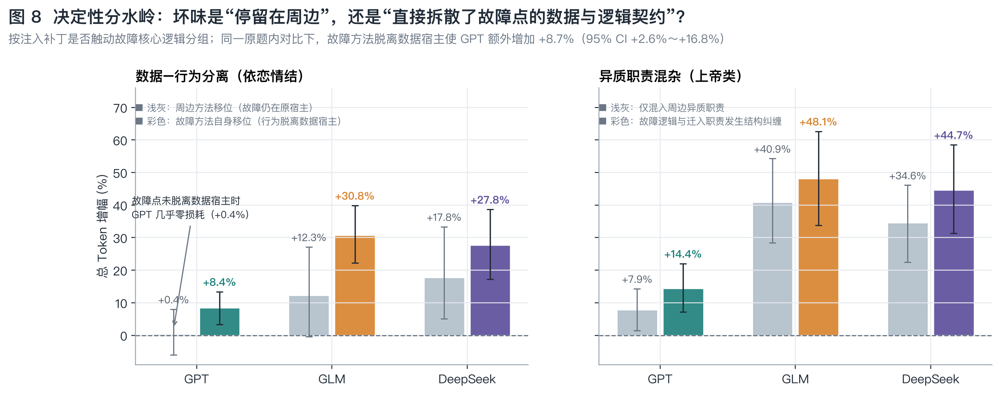

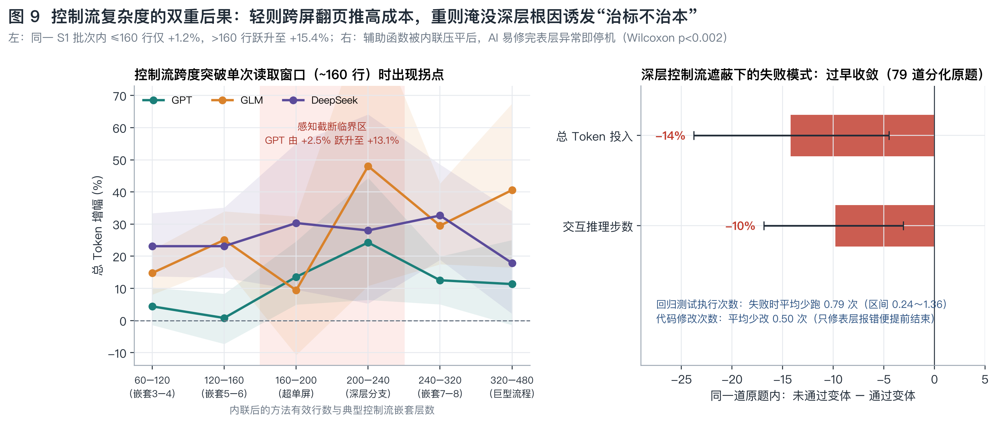

---

## 4 风险分布与因果检验：谁最受伤？是否受批次时间干扰？

- **轻量模型面临近 3 倍爆表风险，日常小改动最吃亏（图 10）**。GLM 与 DeepSeek 在坏味区出现单题 Token 翻倍（≥2×）的比例达 **27.1% 与 23.0%**，是正常重跑波动的 **1.9 倍与 2.6 倍**（GPT 无额外爆表风险）。同时，按客观任务难度分组可见，GPT 在易、中、难任务上固定多花约 **2.5 万 Token** 的“理解门槛费”，导致原本只需改两三行的简单日常需求相对增幅最高（GPT +13.9%、GLM +40.8%，约为复杂任务的 2～3 倍）。
- **“接触坏味前”准实验对照排除分批运行混杂（图 11）**。针对实验按 S2→S1→S0→干净代码 跨天分批执行的时间差，我们以智能体**首次读到受污染文件**为界做前后对照：接触前，三模型的步数（−0.6% ～ +0.9%）、Token（−0.3% ～ +0.8%）与单步输出变化全部紧贴零点；接触后才拉开显著差距，叠加同一小时并发运行的同批次交叉验证，确认结论完全源于代码结构退化。

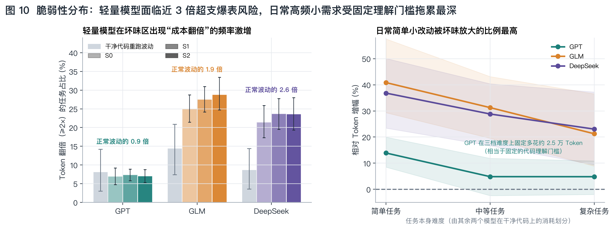

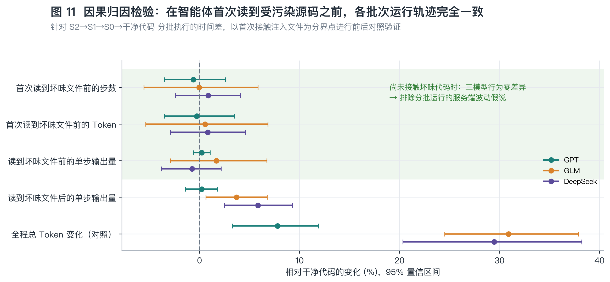

---

## 5 工程治理指南：在什么时机、依据什么指标介入？

传统“等文件膨胀到几千行再按体积拆分”的做法在 AI 时代已经失效。基于上述实证规律，工程治理应遵循以下准则（图 12）：

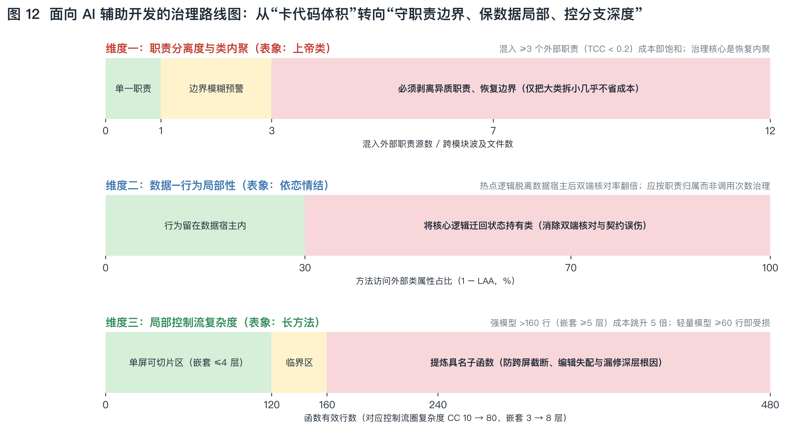

1. **防线前移到“破界之前”，存量按“修改热度 × 故障耦合度”排优先级**。一旦跨文件破界就已产生 68%～88% 的损耗，事后把 6,000 行大类机械切成两个 3,000 行而不恢复内聚，节省成本近乎为零。日常应在代码评审（CR）与合并门禁中重点拦截高频模块“第一次混入异质职责”；存量重构无需折腾无人问津的边缘大文件，只需聚焦满足 $\text{预期触达次数 } N \times \text{单次额外开销 } \Delta T \times \text{单价} > \text{一次性重构成本}$ 的核心热点文件。
2. **分维度守住三条可落地红线**：
    - **职责分离度（针对大类）**：监控热点类是否混入 ≥3 个外部职责或内聚度 TCC 跌破 **0.2**，按业务边界彻底剥离。
    - **数据–行为局部性（针对跨类调用）**：不纠结外部属性访问次数，重点检查核心业务逻辑是否脱离状态持有类（LAA < **0.3**，改一处总需双文件核对），及时将方法迁回数据宿主。
    - **局部控制流跨度（针对长函数）**：将**函数有效代码 150～160 行、最大嵌套 4 层、圈复杂度 20～25** 设为硬性上限（若主力使用轻量高性价比模型，收紧至 **80～100 行**），用语义清晰的具名小函数替代深层内联块。
3. **流程与工具配套护栏**：在复杂耦合模块强制要求智能体运行关联回归测试集后才允许提交补丁（防“过早收敛”漏修）；工具侧采用有界窗口结合语法树大纲导航，并对历史轮次已确认无关的大段源码输出做自动折叠，阻断复利重算。

---

## 6 面向单调影响曲线的 `S1～S3` 坏味分级设计方案与研究边界

### 6.1 构建合理、单调 `S1～S3` 响应曲线的三条全局铁律与参数矩阵

现行 S0–S2 之所以出现平台与倒挂，是因为：(1) S0 起步锁死 `RAD ≥ 3`；(2) 上帝类靠末尾堆孤立方法凑行数（被窗口屏蔽，且 >5,000 行诱发弃读翻页倒挂），依恋情结仅增只读属性（差 19 行）；(3) 三档独立生成导致同一原题下命中完全相同代码单元的比例仅 **27.3%（依恋情结）、59.9%（长方法）、61.7%（上帝类）**。要在下一代基准中获得清晰单调的 `Clean → S1 → S2 → S3` 曲线，需执行以下规范（图 13、表 5）：

- **铁律一：同锚点渐进嵌套（`Clean → S1 → S2 → S3` 逐档叠加）**。固定同一待修复核心方法（E4），`S2` 在 `S1` 补丁上增量演化，`S3` 在 `S2` 上叠加演化，使同目标单元率达 **100%**。
- **铁律二：只递增“局部窗口无法跳过”的认知门槛**。解绑轻度档跨模块锁死，禁靠文件末尾堆孤立方法凑体积，按**“局部感知摩擦（S1）→ 跨窗截断与跨模块消歧（S2）→ 多跳共享契约与深层路标抹除（S3）”**三级递进。
- **铁律三：同题四档同窗口随机交错运行**，消除墙钟耗时的跨批次服务端波动。

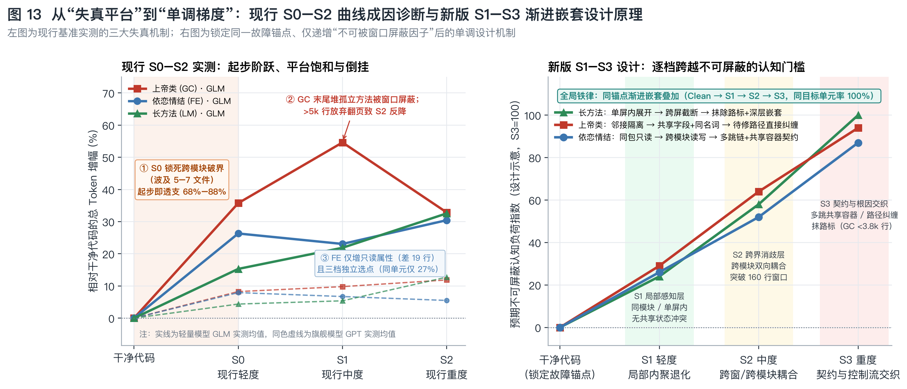

**表 5　面向单调响应曲线的下一代 `S1～S3` 坏味分级注入规范**

| 坏味与核心递增因子 | `S1` 轻度（局部感知层：同模块 / 单屏内） | `S2` 中度（跨界消歧层：跨模块 / 跨窗口） | `S3` 重度（契约与根因交织层：多跳 / 深层压平） |
|---|---|---|---|
| **依恋情结**<br>*委托跳数 × 状态读写 × 共享宿主契约* | **同包单跳只读搬移**：迁入同模块 1 个专用辅助类（**2 文件、1 模块、1 跳**）；仅只读访问原宿主属性（ATFD 4–6，LAA 0.25–0.40）；新宿主无共享契约冲突 | **跨模块双端读写聚合**：迁往另一业务模块，聚合 2–3 个外部状态源（**3–4 文件、2 模块**，ATFD 7–10，LAA 0.10–0.25）；含反向状态回写或双向回调 | **多跳委托链 + 共享容器契约冲突**：跨 **≥3 模块、≥2 跳**委托链（**≥5 文件**，LAA ≤0.10）；终点宿主必须承载 ≥2 条既有业务/测试路径共用的可变状态容器 |
| **上帝类**<br>*共享字段 × 同名词碰撞 × 待修路径纠缠* | **同模块邻接共居（状态隔离）**：吸收同模块 1–2 个辅助类（**500–1,000 行**，TCC 0.20–0.35）；与待修方法不共享可变字段、无调用依赖 | **跨模块混入 + 共享字段与同名词诱饵**：跨 2 模块混入同类职责（**1,200–2,200 行**，TCC 0.08–0.20）；共享 ≥2 个核心可变字段，周边交错布置 3–5 处同名词诱饵 | **枢纽型路径直接纠缠（严控上限 <3,800 行防弃读）**：跨 ≥3 模块融合 ≥6 文件职责（**2,200–3,800 行**，TCC <0.08）；**强制待修方法执行路径直接调用迁入前置校验或状态转换** |
| **长方法**<br>*窗口跨度 × 分支复用 × 抹除语义路标* | **单屏内局部辅助展开**：仅展开本类 1–2 个私有短函数；有效长度 **70–130 行**（修改点距入口 <90 行，留在单屏内），CC 12–22，嵌套 3–4 层，保留高层具名子函数 | **跨单屏截断 + 跨文件分支状态复用**：继续内联同模块 2–3 个文件分支；长度 **160–250 行**（跨过单屏窗口，修改点距入口 ≥140 行或首尾联动），CC 25–45，嵌套 5–6 层 | **跨模块全流程压平 + 100% 抹除具名路标**：将跨 ≥2 模块、≥4 文件的解析/校验/计算/回退全流程压平，彻底抹除中间具名子函数；**260–450 行**，CC 50–85，嵌套 **7–8 层**，含相似重复缩进块 |
| **宏观架构坏味扩展**<br>*契约变更的跨模块传播跳数* | **双模块单向跨层直连**：绕过接口直接依赖相邻模块内部数据结构（需 2 个文件同步核对） | **三模块闭环循环依赖（`A→B→C→A`）**：类型签名或状态初始化形成闭环，单点修改触发环路编译或回调冲突 | **散弹式契约分散 + ≥4 模块环网校验**：同一业务规则散落于 ≥4 模块 ≥5 个类中交叉校验，漏改任一处即集成测试失败 |

### 6.2 研究适用边界与一键复现

1. **热点暴露上限**：本数据 98% 的坏味位于修复必经路径（E4）；远离当前修改点的边缘冷门坏味影响预计大幅衰减。
2. **测试判定覆盖**：仓库目前仅提供 GPT 在 S0 与 S2 下的测试判定报告；补齐轻量模型与中间档位的容器测试后，可进一步量化复杂纠缠对轻量模型通过率的折损。
3. **工具窗口耦合**：约 160 行的函数拐点与 >5,000 行的弃读回落与当前有界读取窗口（~180 行 / 50KB）对应；换用不同感知窗口时数值拐点会相应平移，但“横向孤立堆积可被检索隔离、纵向控制流与跨宿主契约纠缠无法跳过”的底层规律不变。

```bash
# 仓库根目录下使用 Python 3.12 一键复现全部数据、图表、网页/PDF 论文与 12 页演示文稿：
python analysis/smell_paper/parse_traces.py && python analysis/smell_paper/analysis.py
python analysis/smell_paper/figures.py
python analysis/smell_paper/build_paper.py && python analysis/smell_paper/build_slides.py
```
