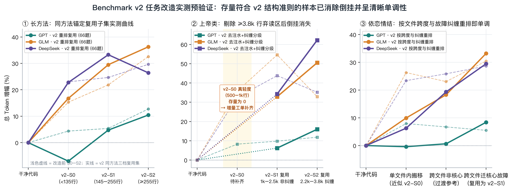

# Benchmark v2 任务改造方案与增量执行套件（`task_redesign`）

本目录将实证分析得出的底层影响机制直接落地为**可执行的下一代单调坏味评测套件（Benchmark v2）**，涵盖**改造版 `S0～S2` 注入提示词模板（含新增模块级循环依赖）**、**存量 2,424 份补丁的重映射复用方案**、**缺失档位的逐题增量容器调度工单**以及**一键工作区组装脚本**。

---

## 一、目录结构与核心产物

| 路径 | 作用说明 |
|---|---|
| `prompts_v2/{S0,S1,S2}/FeatureEnvy.md` | 改造后的**依恋情结**三档注入模板（同包单跳只读 → 跨模块双向读写 → ≥2 跳委托链 + 多调用方共享容器契约） |
| `prompts_v2/{S0,S1,S2}/GodClass.md` | 改造后的**上帝类**三档注入模板（封顶 `<3,800 行` 防弃读倒挂；同模块隔离 → 共享字段+同名词诱饵 → 待修路径直接纠缠） |
| `prompts_v2/{S0,S1,S2}/LongMethod.md` | 改造后的**长方法**三档注入模板（新增故障点行距 `FAULT_OFFSET` 窗口卡位：`<90 行` 首屏内 → `135–220 行` 跨首屏 → `≥220 行` 抹除具名路标） |
| `prompts_v2/{S0,S1,S2}/CyclicDependency.md` | **新增模块级架构坏味（循环依赖与散弹式契约传播）**三档模板（双模块直连 → 三模块强连通环 → ≥4 模块环网与交叉校验） |
| `manifests/v2_code_smell_remap_plan.csv` | 全部 297 题 × 3 类代码坏味 × 3 档（2,424 个槽位）的锚点锁定与动作映射表（`REUSE` 直接复用 vs 增量构造动作） |
| `manifests/incremental_patch_jobs.jsonl` | 面向容器调度器的**全量增量补丁生成工单**（自带锁定的 `locked_target_file`、`locked_target_unit` 与 `seed_smell_patch`） |
| `manifests/incremental_patch_jobs_core100.jsonl` | 优先推荐先跑的 **`Core-100` 纯净分层子集工单**（跨 41 仓库、7 语言均衡抽样且无答案泄露，共 763 条增量任务） |
| `manifests/task_pool_v2.csv` | 297 道原题的上游答案泄露审计标记表（分离出 **232 道无泄露纯净题**与 `Core-100` 标记） |
| `manifests/redesign_summary.json` | 复用率、超标剔除数与增量工单统计汇总 |
| `assemble_v2_workspace.py` | 将存量可直接复用的 **1,110 份补丁**一键组装为标准 `smell-patch/{S0,S1,S2}/` 目录结构 |
| `figures/v2_redesign_validation.png` | 基于存量轨迹数据的改造前后曲线实测预验证图 |

---

## 二、相比旧版（v1）做了哪五项核心改造？

### 1. 修正旧版提示词笔误，建立“同锚点链式嵌套”铁律
- **修复原模板笔误**：修正了旧版 `prompts/S0/FeatureEnvy.md` 将 `LAA` 误写为 `0.2 < FDP <= 0.3`、以及 `prompts/S0–S1/GodClass.md` 将 `WMC / TCC` 阈值变量误写为 `LOC`、判定说明误写为 `LCOM` 的问题。
- **100% 同锚点锁定（消除选点漂移）**：旧版三档独立从 Base 抽样，导致同一道题三档命中同一目标单元的比例仅 **27.3%（FE）、59.9%（LM）、61.7%（GC）**。新版在 `v2_code_smell_remap_plan.csv` 中为每道题唯一锁定了 `E4` 核心故障单元，并通过 `seed_smell_patch` 支持链式增量演进（`Clean -> S0 -> S1 -> S2`）或从 `S2` 母本反向抽回（`LM`）。

### 2. 解绑 S0 的跨模块硬锁死，分坏味对齐真实认知门槛

| 坏味类型 | 旧版 v1 失真原因 | 新版 v2 `S0`（真轻度） | 新版 v2 `S1`（跨界中度） | 新版 v2 `S2`（强纠缠重度） |
|---|---|---|---|---|
| **Feature Envy** | 三档均只搬 1 个方法（仅差 19 行），且 S0 已锁死跨模块 `RAD≥3` | **同包单跳只读**（`文件=2, 模块=1`，`ATFD 4–6`，无共享契约冲突） | **跨模块双向读写**（`文件=3–4, 模块=2`，`ATFD 7–10`，含状态回写/回调） | **≥2 跳委托链 + 共享容器契约**（`文件≥5, 模块≥3`，终点宿主承载 ≥2 条既有业务/测试契约） |
| **God Class** | 往末尾横向堆孤立并列方法被局部窗口屏蔽；`≥5k 行`诱发放弃翻页致 S2 倒挂 | **同模块邻接隔离**（`500–1,000 行, 模块=1`，不与待修方法共享可变字段） | **跨 2 模块 + 共享字段与同名词诱饵**（`1,000–2,200 行`，共享 ≥2 字段，交错布置 3–5 处同名词方法） | **待修路径直接纠缠 + 硬限高 `<3,800 行`**（`2,200–3,800 行, 模块≥3`，待修方法必经调用迁入前置逻辑） |
| **Long Method** | 仅控方法总行数，未控修改点行距（若修改点仍在方法前部，首屏一次即可读到） | **单屏内展开**（`70–130 行, CC 12–22, 嵌套 3–4`，修改点距入口 `FAULT_OFFSET < 90 行`） | **跨单屏窗口截断**（`150–250 行, CC 24–45, 嵌套 5–6`，`135 ≤ FAULT_OFFSET < 220 行`） | **跨模块全压平 + 抹除路标**（`260–460 行, CC 48–85, 嵌套 7–8`，`FAULT_OFFSET ≥ 220 行`，100% 抹除中间具名子函数） |
| **Cyclic Dependency**<br>*(新增架构坏味)* | 旧版缺失模块级坏味 | **双模块双向紧耦合**（`SCC=2, 跨模块运行边 2–3`） | **三模块闭环循环依赖**（`M1→M2→M3→M1, SCC=3`） | **≥4 模块强连通环网 + 散弹式契约交叉校验**（`SCC≥4, 涉及 ≥5 文件`） |

### 3. 存量补丁精准盘点：直接复用 45.8%（1,110 份），剔除 312 份超长失真补丁

通过 `build_redesign_plan.py` 对全部 2,424 份存量补丁逐一核验，**近一半代码坏味槽位可直接平移复用**，无需重跑容器注入：

| 坏味与新档位 | 直接复用存量（`REUSE`） | 需增量构造工单数 | 改造动作说明 |
|---|---:|---:|---|
| `FE` · `v2-S0` | **35** | 232 | 复用存量同文件/同单元 `E4` 搬移；其余补构 `BUILD_S0_SAME_MOD`（同包单跳只读） |
| `FE` · `v2-S1` | **215（80.5%）** | 52 | 存量跨文件搬移核心故障方法（`E4 + entangled=1`）直接平移为新中度档 |
| `FE` · `v2-S2` | **0** | 267 | 以 `v2-S1` 补丁为种子，增量扩展第 2 跳至共享状态容器（`EXTEND_S2_MULTI_HOP`） |
| `GC` · `v2-S0` | **0** | 264 | 存量无 `<1,000 行` 样本，补构 `BUILD_S0_LIGHT_GC`（500–1k 行同模块隔离） |
| `GC` · `v2-S1` | **254（96.2%）** | 10 | 存量旧 `S0`（1k–2.5k 行跨模块混入）直接平移为新中度档 |
| `GC` · `v2-S2` | **50** | 214 | **剔除 312 份 `≥3,800 行` 注水旧补丁**；复用 50 份 `<3,800 行` 已纠缠补丁，其余基于旧 `S0` 增量织入路径纠缠 |
| `LM` · `v2-S0` | **189（68.2%）** | 88 | 复用同锚点 `<135 行` 补丁；缺失项直接从 `S2` 母本反向抽回具名函数（`REVERSE_EXTRACT`） |
| `LM` · `v2-S1` | **171（61.7%）** | 106 | 复用同锚点 `145–255 行` 补丁；缺失项从 `S2` 母本反向抽回生成 |
| `LM` · `v2-S2` | **196（70.8%）** | 81 | 复用同锚点 `255–480 行` 补丁（其中 **66 道题**三档全部现成满足同锚点单调复用） |
| **代码坏味合计** | **1,110（45.8%）** | **1,314**（纯净池 **1,030**） | 另含纯净池 232 题的新增模块级 `CyclicDependency` 工单 696 条 |



如上图实测预验证所示：仅对存量符合 `v2` 结构标准的样本按新规则重排，**上帝类剔除 `≥3,800 行` 弃读区并区分路径纠缠后，三模型原有的 S2 倒挂彻底消失并转为陡峭上升**（GLM `+32.9% → +50.4%`，DeepSeek `+34.4% → +62.4%`，GPT `+6.1% → +16.0%`）；依恋情结与长方法同锚点子集也均呈现清晰的单调递增。

### 4. 隔离上游答案泄露（确立 232 道纯净任务池与 `Core-100`）
结合 `analysis/smell_impact/answer_access_by_task.csv` 的轨迹审计，旧版 297 道题中有 **65 道题**曾出现模型通过 `webfetch` 拉取同编号上游 PR diff 或通过本地 Git 历史读取修复提交。`manifests/task_pool_v2.csv` 已将这 65 题显式隔离标记，保留 **232 道纯净无泄露原题**，并从中按 41 个仓库与 7 种语言分层均衡抽取了 **`Core-100` 优先子集**（若算力有限，只需跑 `incremental_patch_jobs_core100.jsonl` 的 763 条增量工单即可建成覆盖全部四类坏味的 100 题标准基准）。

---

## 三、使用与调度接入指南

### 步骤 1：一键组装存量可直接复用的 1,110 份补丁
```bash
# 默认以软链接方式快速组装至 analysis/task_redesign/assembled_v2/（加 --clean-only 仅保留 232 道无泄露纯净题）
python analysis/task_redesign/assemble_v2_workspace.py --mode symlink --clean-only
```

### 步骤 2：将增量工单接入 SWE-bench Docker 注入调度器
读取 `manifests/incremental_patch_jobs_core100.jsonl`（快速版）或 `manifests/incremental_patch_jobs.jsonl`（全量版）。每条 JSON 工单格式如下：
```json
{
  "instance_id": "apache__druid-14092",
  "repo": "apache__druid",
  "lang": "Java",
  "smell": "GodClass",
  "new_level": "S2",
  "action": "EXTEND_S2_ENTANGLED_CAP3800",
  "prompt_template": "analysis/task_redesign/prompts_v2/S2/GodClass.md",
  "locked_target_file": "server/src/main/java/org/apache/druid/discovery/DruidLeaderClient.java",
  "locked_target_unit": "DruidLeaderClient",
  "seed_smell_patch": "smell-patch/S0/GodClass/apache__druid-14092-GC.patch",
  "seed_gold_patch": null,
  "clean_no_leak": true,
  "priority_core100": true
}
```
- 若 `seed_smell_patch` 非空：容器启动到 `base_commit` 后可先参考或应用该种子补丁，在其同一目标文件 `locked_target_file` 与目标单元 `locked_target_unit` 上增量演进（或对 `REVERSE_EXTRACT_*` 从旧 `S2` 母本抽回辅助函数），最后仍相对原始 `HEAD (base_commit)` 导出完整 `git diff HEAD` 作为新档位的独立 `smell.patch`。

### 步骤 3：Agent 求解评测阶段的三条防混杂规范
1. **封堵外部与历史答案通道**：在 OpenCode / 求解容器配置中**禁用 `webfetch` / `websearch` 等联网工具**；容器初始化时执行 `git tag -d $(git tag)` 并清理晚于 `base_commit` 的孤立 refs/remotes，防止模型从 Git 历史读取上游修复。
2. **同题四档同窗口随机交错调度**：将同一道 `instance_id` 的 `Clean / S0 / S1 / S2` 放在同一时间窗口内随机打乱并发执行，彻底消除跨天分批运行带来的服务端墙钟耗时漂移。
3. **全档位运行容器测试判定**：对所有评测模型（包括旗舰模型与轻量模型）完整执行 `S0 / S1 / S2` 的测试集判定，同步产出“Token/步数单调递增曲线”与“通过率单调衰减曲线”。
